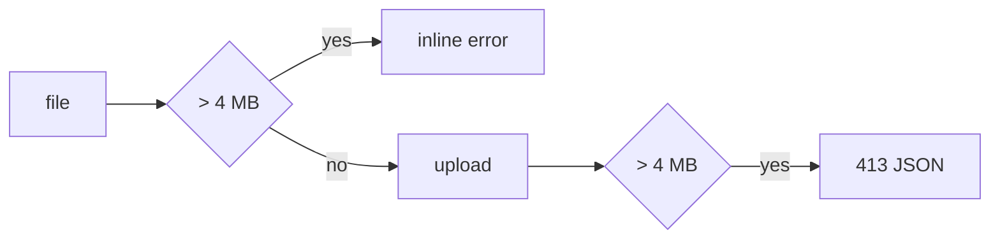

# Handoff: PR-75 / T-125
## Builder notes
### What changed
- `src/lib/audioLimit.ts` (new): `MAX_AUDIO_BYTES` = 4 MB, the shared message and hint, `checkAudioSize()`.
- `/api/upload/audio`: over 4 MB returns 413 + JSON `{ error: "Audio files can be up to 4 MB. Try a shorter clip or a 128 kbps MP3." }` (was plain text, 15 MB, unreachable on Vercel).
- `RoomPanel`: checks `file.size` before uploading, so oversize files show the message inline (role=alert) with no request; hint "MP3, WAV, OGG or M4A, up to 4 MB".
### Why
Vercel's function body limit (~4.5 MB) returned a raw 413 FUNCTION_PAYLOAD_TOO_LARGE before our code ran.
### Diagram

### How to test
`npx vitest run src/app/api/upload/audio src/panels/RoomPanel.test.tsx`. Live after merge: upload a 3.5 MB MP3 in Room → Custom Song (OK) and a 5 MB one (inline message, no network request).
## Review rounds
### Round 1
**Verdict** / **Blocking issues** / **Non-blocking suggestions** / **What I tested**
## DevOps notes
CI result / merge commit / release note

### DevOps completion
Squash merged 0e9f73c4a5280718c19a3d7f92c32a42e3ac93b2 after approved card, review-approved and green ci/docs-guard; prior main production SUCCESS and three-minute spacing verified. Production/live smoke monitored separately; requested 3.5 MB audio upload check from builder-3.

Live acceptance: builder-3 verified3.5MB MP3 upload201 and4MB+1 response413 with new JSON. Auth smoke6/6 passed; publish-view failed intermittently on title-save assertion. Escalated live failure; no attribution to audio cap established.
