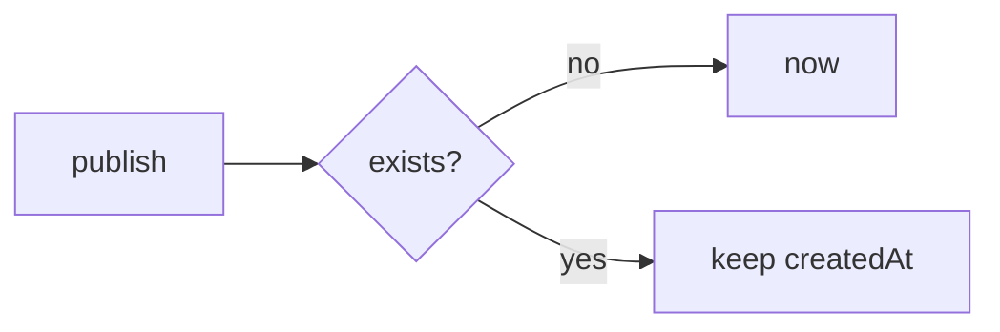

# Handoff: PR-76 / T-126
## Builder notes
### What changed
`src/lib/auth/ownership.ts`: `recordGalleryOwner(entry, storage, now = () => new Date())`. A new index entry gets `createdAt = now()` (the real publish time); an existing entry keeps its original createdAt (title and links refresh). The caller's createdAt is optional and ignored, so galleries/route.ts is untouched. Existing stored entries are unchanged.
### Why
The index copied the gallery document's createdAt (date-only/midnight UTC), so "Your galleries" showed the previous day in US time zones, and re-publishing overwrote it.
### Diagram

### How to test
`npx vitest run src/lib/auth`: the fixed-clock test publishes at 2026-10-11T01:00Z → stored as-is, shows 10/10/2026 in America/New_York; re-publish keeps it.
## Review rounds
### Round 1
**Verdict** / **Blocking issues** / **Non-blocking suggestions** / **What I tested**
## DevOps notes
CI result / merge commit / release note
