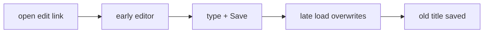

# Handoff: PR-79 / T-117 (regression for T-135)
## Builder notes
### What changed
`tests/e2e/edit-link.spec.ts` (new, tests only): publish a 1-room gallery via the API → open its edit link → as soon as `[data-room-id]` shows, type a title, open Publish, Save → expect "Saved.", the field keeps the title, `GET /api/galleries/<id>` has it, and it survives a reload.
### Result on prod (62e70a7)
`--repeat-each=20`: 19 pass, 1 FAIL (Expected "Edited Right Away", Received "Original Title" right after Save), which is the T-135 bug. publish-view: 9/10 the same session (step 5 Publish panel vanished, the same race).
### Root-cause pointers (for builder-1's T-135 fix)
`src/app/edit/[id]/page.tsx`: `isLoading` starts false (an editor renders before its gallery loads), and the load effect depends on Promise props (propParams/propSearchParams), so a re-render may re-run the fetch → `loadGallery()` overwrites edits.
### Gate
`E2E_BASE_URL=<T-135 preview> npx playwright test edit-link.spec.ts publish-view.spec.ts --project=chromium --repeat-each=20` → 20/20 each.
### Diagram

## Review rounds
### Round 1
**Verdict** / **Blocking issues** / **Non-blocking suggestions** / **What I tested**
## DevOps notes
CI result / merge commit / release note

## DevOps notes
CI: ci + docs-guard SUCCESS at 7e8889a. Merge commit: 140c07e233c33450efe66a9ab670ceb6612f1762 (squash via devops gate, 2026-10-10T21:29:15Z, head pinned). Approved by Quang (recorded via senior) + review-approved. Test-only change. Release note: releases/CHANGELOG.md.
