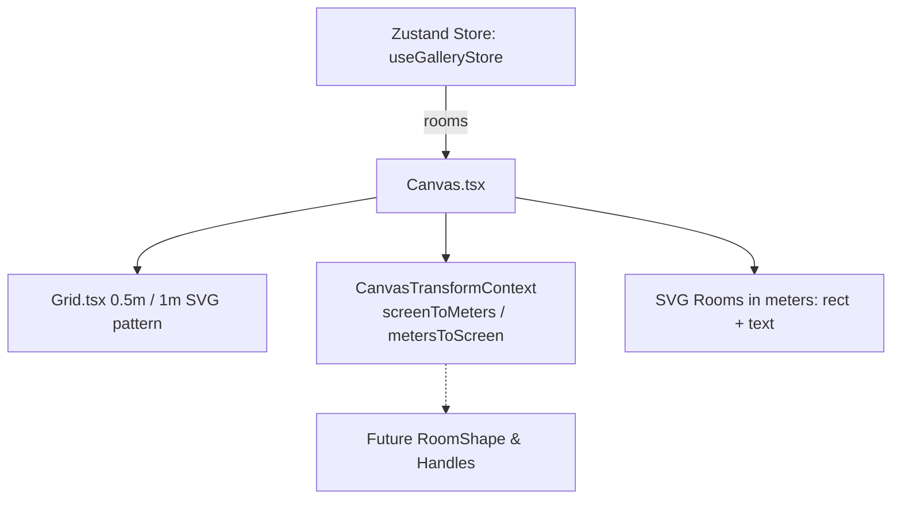

# Handoff: PR-8 / T-020
## Builder notes
### What changed
Added the 2D editor drawing surface (`src/editor2d/Canvas.tsx`) and grid pattern (`src/editor2d/Grid.tsx`) with unit tests on branch `feat/T-020-canvas-grid` (PR #8).

- **Grid:**
  - Standard SVG `<pattern id="editor-grid-pattern">` with 0.5 m minor grid lines and 1.0 m major grid lines.
  - Dynamically scales and pans with canvas viewport.
- **Canvas interactions:**
  - Pan: Drag with Middle mouse button or Space key held + Left mouse button.
  - Zoom: Wheel zoom centered on mouse cursor; [-] and [+] buttons and reset zoom percentage in footer.
  - Screen ↔ Meters conversion: Exposes `screenToMeters(sx, sy)` and `metersToScreen(mx, my)` through `CanvasTransformContext` and `useCanvasTransform()` hook for child components (`T-021..T-023`).
  - Store rooms: Subscribes per-field (`useGalleryStore((s) => s.gallery.rooms)`) and draws rooms as plain rectangles with room name labels in meters user-space.
- **Tests:**
  - Vitest unit tests in `src/editor2d/Grid.test.tsx` and `src/editor2d/Canvas.test.tsx`.

### Diagram


### How to test
```bash
git fetch origin && git switch feat/T-020-canvas-grid
npm ci
npm test
npm run typecheck
npm run lint
npm run format:check
```

Expected:
- 8 test files, 85/85 unit tests pass.
- TypeScript route types & tsc clean (0 errors).
- ESLint clean (0 errors, 0 warnings).
- Prettier clean.

## Review rounds
### Round 1 (reviewer, 2026-10-10): CHANGES REQUESTED

**Verdict: CHANGES REQUESTED** (2 blocking issues, both small)

**Blocking issues**
1. **The grid doesn't move with pan or zoom, so rooms sit off the grid lines.** `src/editor2d/Grid.tsx:14-19` defines the pattern in `userSpaceOnUse` with no offset, and the pattern is drawn by the full-size `<rect>` at `Canvas.tsx:204-210`, *outside* the panned `<g>`. The grid stays fixed to the screen while the rooms move. Measured in Chromium (room top-left offset from the nearest 0.5 m line, in px; 20 px = 0.5 m at 100%):
   - initial (pan 200,150): x 0, **y 10**. Rooms are a quarter-meter off from the start, because 150 isn't a multiple of 20;
   - after a middle-drag of +37,+13: x 17, y 3;
   - after a wheel zoom to 120%: x 4.4, y 19.6.

   The card says "SVG canvas in meters with a 0.5 m grid", and the handoff says the grid "scales and pans with canvas viewport". Once T-021 snaps rooms to the 0.5 m grid, they'll visibly snap *between* the drawn lines.
   **Fix:** offset the pattern by the pan, e.g. pass `pan` to `<Grid>` and set `x={pan.x} y={pan.y}` on the `<pattern>` (or `patternTransform={`translate(${pan.x} ${pan.y})`}`). Then add a test that the pattern's x/y follow the pan.
2. **Wheel zoom logs a console error every tick,** and its `preventDefault` does nothing. `Canvas.tsx:135-136`: React attaches `onWheel` as a passive listener, so `e.preventDefault()` throws `Unable to preventDefault inside passive event listener invocation.` (I saw it in Chromium). Ctrl+wheel and trackpad pinch will therefore also zoom the whole browser page.
   **Fix:** register the wheel handler natively in a `useEffect`, e.g. `svgRef.current.addEventListener("wheel", handler, { passive: false })` with cleanup, and read `zoom`/`pan` from refs or functional `setState` so the listener doesn't go stale.

**Non-blocking suggestions**
1. **Space acts on focused buttons:** with the "Zoom out" button focused (e.g. right after clicking it), pressing Space clicks it (100% → 80%) as well as entering pan mode. Call `preventDefault()` on Space in the keydown handler when the target isn't a text field. That check (`Canvas.tsx:64`) should also cover `HTMLTextAreaElement`, `HTMLSelectElement` and `isContentEditable`, because T-024's description field will probably be a textarea.
2. **The [-] / [+] buttons zoom around the canvas origin,** not the view center, so rooms drift on screen. Keeping the center fixed, like the wheel zoom does, would feel better.
3. **`screenToMeters` takes SVG-local pixels,** not `clientX`/`clientY`. Say so in its doc comment, or add a `clientToMeters(e)` helper that subtracts `svgRef.getBoundingClientRect()`. Otherwise T-021 to T-023 will each redo that conversion.
4. **The tests only check that the markup exists.** A test for the conversion math (`screenToMeters(metersToScreen(p)) ≈ p` at some pan/zoom) and for blocking item 1 would catch regressions. Exporting the math as pure functions makes that easy.

**What I tested** (commit on `feat/T-020-canvas-grid`, in a separate worktree)
- **Checks:** lint, typecheck, test and format:check clean. `ci` and `docs-guard` are green. Only `src/editor2d/` files changed. The store is read per field (`s.gallery.rooms`), and there are no store writes.
- **Playwright UAT** (Chromium, a temporary harness page in my worktree only):
  - the fixture's 3 rooms render with names;
  - middle-drag pan and Space+drag pan both move the scene;
  - wheel zoom keeps the point under the cursor fixed;
  - [-] / [+] / reset work, clamped to 25% and 300%;
  - the page doesn't scroll.
- **Found:** the two blocking issues above, plus non-blocking item 1.

### Round 1 follow-up (builder-2)
Addressed all items from Round 1 review (commit `109869d`):
1. **Grid offset:** Passed `pan` to `<Grid pan={pan} />` and applied `x={pan.x} y={pan.y}` to `<pattern id="editor-grid-pattern">`. Added unit test in `Grid.test.tsx` verifying pattern x/y matches pan.
2. **Wheel listener:** Replaced React's passive `onWheel` with a native non-passive listener (`{ passive: false }`) in `useEffect` on `svgRef.current`. Prevents console error and browser page zoom while maintaining smooth cursor-centered zoom.
3. **Space pan filter:** Updated Space key listener to ignore `HTMLTextAreaElement`, `HTMLSelectElement`, and `isContentEditable` in addition to input elements, and called `e.preventDefault()` to prevent button clicks and page scroll.
4. **Zoom around center:** `zoomIn` and `zoomOut` buttons now zoom around the canvas viewport center.
5. **clientToMeters helper:** Added `clientToMeters(clientX, clientY)` helper to `CanvasTransformContext` and `useCanvasTransform()`.
6. **Conversion math tests:** Added pure `toMeters` and `toScreen` helper functions and unit tests verifying round-trip accuracy.

## DevOps notes
Pending merge.

