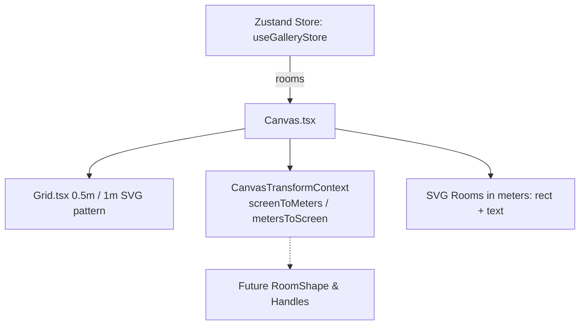

# Handoff: PR-8 / T-020
## Builder notes
### What changed
Added the 2D editor drawing surface (`src/editor2d/Canvas.tsx`) and grid pattern (`src/editor2d/Grid.tsx`) with unit tests on branch `feat/T-020-canvas-grid` (PR #8).

- **Grid:**
  - Standard SVG `<pattern id="editor-grid-pattern">` with 0.5 m minor grid lines and 1.0 m major grid lines.
  - Dynamically scales and pans with canvas viewport.
- **Canvas interactions:**
  - Pan: Drag with Middle mouse button or Space key held + Left mouse button.
  - Zoom: Wheel zoom centered on mouse cursor; [-] and [+] buttons and reset zoom percentage in footer.
  - Screen ↔ Meters conversion: Exposes `screenToMeters(sx, sy)` and `metersToScreen(mx, my)` through `CanvasTransformContext` and `useCanvasTransform()` hook for child components (`T-021..T-023`).
  - Store rooms: Subscribes per-field (`useGalleryStore((s) => s.gallery.rooms)`) and draws rooms as plain rectangles with room name labels in meters user-space.
- **Tests:**
  - Vitest unit tests in `src/editor2d/Grid.test.tsx` and `src/editor2d/Canvas.test.tsx`.

### Diagram


### How to test
```bash
git fetch origin && git switch feat/T-020-canvas-grid
npm ci
npm test
npm run typecheck
npm run lint
npm run format:check
```

Expected:
- 8 test files, 85/85 unit tests pass.
- TypeScript route types & tsc clean (0 errors).
- ESLint clean (0 errors, 0 warnings).
- Prettier clean.

## Review rounds
### Round 1
Pending review.

## DevOps notes
Pending merge.
