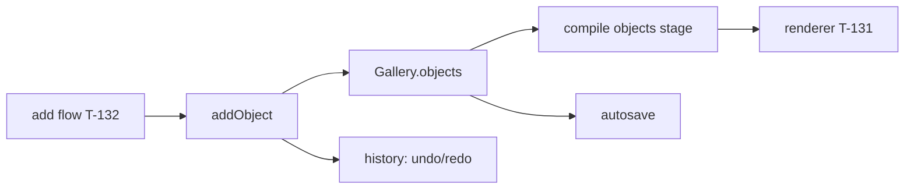

# Handoff: PR-85 / T-128 store part (object actions + undo)
## Builder notes
### What changed
- `src/store/gallery.ts`: `Selection` gains `{ kind: "object", id }`; `addObject(source, roomId)` (room-centre via `newObject`, selects it, `null` for an unknown room); `updateObject(id, patch)` (roomId move validated, noop-safe); `removeObject(id)` (clears a selected object); `deleteRoom` drops the room's objects and clears object selections, but leaves documents without an `objects` key keyless (strictly additive).
- `src/store/history.ts`: `staleSelection` covers the object kind, so undo/redo never leaves a dangling object selection. History itself needed no change: it already snapshots any `gallery` change.
- Autosave needs no change (whole-document JSON already includes `objects`).
### Result
- Full unit suite 75 files / 581 tests pass (8 new: 7 in `gallery.test.ts`, 1 in `history.test.ts`). eslint + `tsc --noEmit` clean.
- Part 1 (schema/validate/compile, PR #73) already merged; this branch is based on current main (6e1cc4f, post T-124/T-135/T-129/T-131/T-133).
### Root-cause pointers
- None (feature, not a fix).
### Gate
- `npx vitest run src/store` green; reviewer checks the T-128 acceptance items for the store scope (round-trip via existing schema/compile + new actions; undo/redo add/move/delete).
### Diagram

## Review rounds
### Round 1
**Verdict** / **Blocking issues** / **Non-blocking suggestions** / **What I tested**
## DevOps notes
CI result / merge commit / release note
