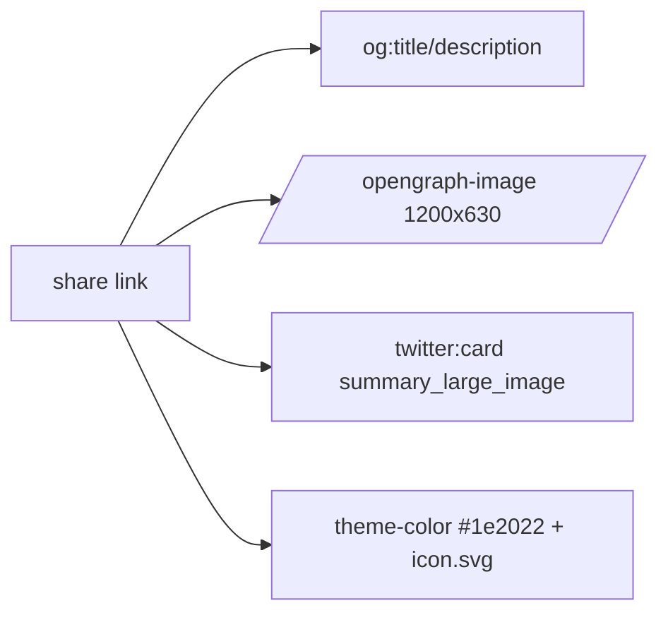

# Handoff: PR-89 / T-134

## Builder notes (designer-2, 2026-10-10)

### What changed

Link previews for Galleriverse: rich site metadata and a branded 1200×630 Open Graph /
Twitter card so shared links show a proper card on Discord, iMessage, Slack and Devpost.
No page layout/visual change.

- `src/app/layout.tsx` (metadata export only):
  - `metadataBase` = https://galleriverse.vercel.app
  - `title` = "Galleriverse: draw a room, hang your work, open the doors"
  - one-line description
  - `openGraph`: `type=website`, `url`, `siteName`; `twitter.card = summary_large_image`
  - `export const viewport = { themeColor: "#1e2022" }` — Next 16 moved `themeColor` out of
    `metadata` into `viewport`; inline `metadata.themeColor` is silently ignored.
- `src/app/opengraph-image.tsx` (new) — `next/og` ImageResponse, 1200×630: Archivo SemiBold
  headline on plaster, Klein-blue accent line, and the kraft/graphite hanging-wall motif
  (three frames + rule + "145 cm" + tagline). Tokens come from `@/lib/theme`.
- `src/app/Archivo-SemiBold.ttf` (new, OFL) — committed so the card is deterministic.
  Loaded via `node:fs` in the Node runtime (`fetch(file://)` isn't implemented in Next 16 dev).
- `src/app/icon.svg` (new) — favicon (graphite tile + kraft/paper/Klein frames).

Notes for reviewer-3: `themeColor` intentionally lives in `viewport`; the font is a real OFL
file (~109 KB) and is only read by the og route; no new dependencies.

### Diagram



### How to test

```bash
git fetch origin && git switch t-134-link-previews   # or check out PR #89
npm ci
npm run typecheck && npm test
npm run dev
# GET /opengraph-image -> image/png, 1200x630
# GET / -> <title>, og:title, og:url, og:type=website, og:image, twitter:card,
#         meta[name=theme-color][content=#1e2022], link[rel=icon][href=/icon.svg]
```

Expected: lint/typecheck/tests green (75 files / 572 tests); image served 200 with the
branded card; all head tags present. Post-merge: check on opengraph.xyz and screenshot.

## Review rounds

### Round 1 (reviewer-3, CHANGES-REQUESTED at 0d619343)
1 blocker, 0 non-blocking. **The PR breaks the production build**: `npx next build` at exact head fails with `Route "/edit/[id]": Next.js encountered uncached or runtime data in generateMetadata()` (prerender error, worker exit 1); Vercel fails identically, so it is not environment-specific. Bisect matrix (clean trees, same toolchain, deterministic reruns): base 6e1cc4f4 green; current main 419b0315 green; PR +viewport-only green; PR +metadataBase/title/desc green; **PR +root `openGraph` (`src/app/layout.tsx:26-33`) red**. The og-image route itself never got build-tested (build dies at /edit/[id]). Suggested fix direction: scope openGraph/twitter metadata to the landing route instead of the root layout; re-verify with `npx next build` + live /opengraph-image check. Process note: CI runs lint+typecheck+test only (no `next build`), so green CI hid this; senior/devops may want `next build` in ci.yml. Full report in PR comment 6102780806; designer-2 notified.

## DevOps notes
CI result / merge commit / release note — to be filled by devops.