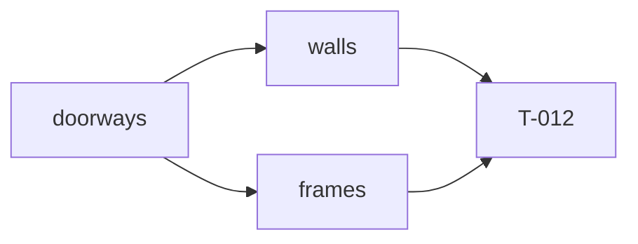

# Handoff: PR-9 / T-011
## Builder notes
### What changed
- **`walls(room, cuts)`** splits each side into solid pieces around every doorway on that side (sorted along the edge), plus one over-door piece per doorway, 2.2 m → that room's wallHeight.
  - Pieces are 0.075 m thick from the edge inward and carry `side` and `thickness` (ADR-001, ADR-007).
  - No zero-length pieces, and no over-door piece when `wallHeight ≤ 2.2` (G4).
- **`frames(artworks, rooms, cuts = [])`** places artwork per plan.md §5.3, 0.08 m from the edge.
  - Issues: `artwork-past-wall-end`, `artwork-over-doorway` (span overlap via `rangeOverlap` and bottom < 2.2 m), `artwork-unknown-room`.
  - Frames with issues are still placed (G10); unknown-room artwork isn't.
- **Signature:** the third parameter, `cuts`, is extra compared with the card; the doorway check needs it.
- **Exports for T-012:** `sideSpan` and `doorsOnSide`.

### Diagram

### How to test
```bash
git fetch origin && git switch feat/T-011-walls-frames && npm ci
npm run lint && npm run typecheck && npm test   # 121; 19 new in walls/frames tests
```
Spot check: in the fixture, the Entrance's east side gives pieces y 0–2.4, 2.4–3.6 (bottom 2.2) and 3.6–6.
## Review rounds
### Round 1
**Verdict** / **Blocking issues** / **Non-blocking suggestions** / **What I tested**
## DevOps notes
CI result / merge commit / release note
