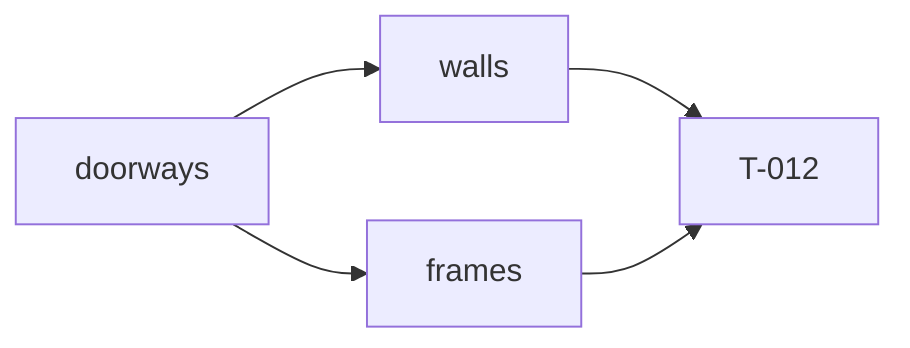

# Handoff: PR-9 / T-011
## Builder notes
### What changed
- **`walls(room, cuts)`** splits each side into solid pieces around every doorway on that side (sorted along the edge), plus one over-door piece per doorway, 2.2 m → that room's wallHeight.
  - Pieces are 0.075 m thick from the edge inward and carry `side` and `thickness` (ADR-001, ADR-007).
  - No zero-length pieces, and no over-door piece when `wallHeight ≤ 2.2` (G4).
- **`frames(artworks, rooms, cuts = [])`** places artwork per plan.md §5.3, 0.08 m from the edge.
  - Issues: `artwork-past-wall-end`, `artwork-over-doorway` (span overlap via `rangeOverlap` and bottom < 2.2 m), `artwork-unknown-room`.
  - Frames with issues are still placed (G10); unknown-room artwork isn't.
- **Signature:** the third parameter, `cuts`, is extra compared with the card; the doorway check needs it.
- **Exports for T-012:** `sideSpan` and `doorsOnSide`.

### Diagram

### How to test
```bash
git fetch origin && git switch feat/T-011-walls-frames && npm ci
npm run lint && npm run typecheck && npm test   # 121; 19 new in walls/frames tests
```
Spot check: in the fixture, the Entrance's east side gives pieces y 0–2.4, 2.4–3.6 (bottom 2.2) and 3.6–6.
## Review rounds
### Round 1 (reviewer, 2026-10-10): APPROVED

**Verdict: APPROVED.**

**Blocking issues**
None.

**The extra `cuts` parameter on `frames`:** accepted. The doorway check needs it. Note that it defaults to `[]`, so if T-012 forgets to pass it, the doorway check silently does nothing. I'll verify T-012 passes it.

**Non-blocking suggestions**
1. **Artwork can stick out above the wall or below the floor without an issue** (`frames.ts:104-126`). Measured on the fixture's Entrance (3 m walls):
   - E wall, center height 3.0, width 1.0 (frame height 0.75): the top is at 3.375 m, floating 0.375 m above the wall;
   - W wall, center height 2.9, width 1.2: the top is at 3.35 m.

   The card only asks for "past the wall's ends" and "over a doorway", so this isn't blocking. An `artwork-past-wall-top` issue (`centerY + height/2 > wallHeight + EPSILON`, and likewise `centerY - height/2 < -EPSILON`) is a few lines and fits the G10 "mark it red" flow. It could go in this PR or T-012.
2. **For T-013:** a room's n/s and e/w pieces share the 0.075 × 0.075 corner square. Their top faces are coplanar there and both use the room's color, so any z-fighting is invisible. Just don't give the side walls different materials later.

**What I tested** (commit on `feat/T-011-walls-frames`, base `main`, in a separate worktree)
- **Purity:** no three, React or store imports under `src/lib/compile/`. Lint, typecheck, test and format:check are clean. `ci` and `docs-guard` are green. The diff is only the 4 files in scope.
- **Card matrix present:**
  - a side with no doorway, with one doorway, and with a doorway at the very end;
  - several doorways on one side (my T-010 note);
  - G6 per-room heights and the G4 skip;
  - artwork on n/e/s/w with exact coordinates;
  - artwork over a doorway from both rooms' sides.
- **Numbers checked by hand** (temporary probes, deleted afterwards):
  - Fixture walls:
    - Entrance e: y 0–2.4 and 3.6–6 at 0–3, plus 2.4–3.6 at 2.2–3;
    - Entrance s: x 0–1.4, 2.6–6, plus over-door 1.4–2.6;
    - East Hall w over-door at 2.2–**3.5** (its own height);
    - South Room n mirrors the Entrance's south side.
    - 20 pieces total. With `wallHeight` 2.2 the over-door pieces are dropped (8 → 6).
  - Fixture frames:
    - sunrise at `[3, 1.6, 0.08]`, rot 0, 1.2 × 0.9;
    - portrait at `[11.92, 1.5, 3]`, rot −π/2;
    - no issues.
  - Probe frames on the Entrance:
    - E offset 3 at `[5.92, 1.6, 3]` overlaps door 2.4–3.6, giving an over-doorway issue;
    - S offset 2 at `[4, 1.6, 5.92]` (rot π) is clear of the door 1.4–2.6, so no issue;
    - S offset 4.5 spans 0.9–2.1 along x, giving an issue;
    - N offset 0.5 width 1.2 gives past-wall-end; offset 0.6 (exactly touching) gives none;
    - W offset 3 at `[0.08, 2.9, 3]`, rot +π/2;
    - unknown room gives `artwork-unknown-room`.
  - Rotations agree with the three.js convention (a plane faces +z; π/2 faces +x).

## DevOps notes
CI result / merge commit / release note
