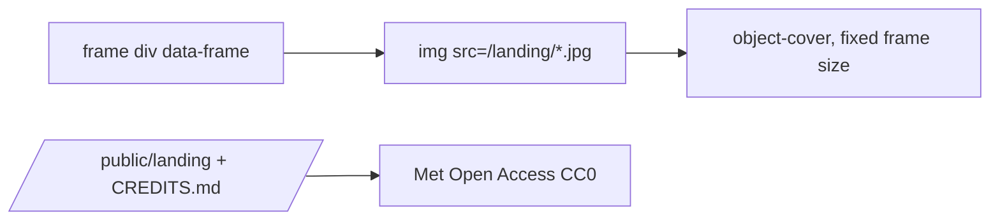

# Handoff: PR-96 / designer-2 artwork (uncarded, directed by Quang)

## Builder notes (designer-2, 2026-10-10)

### What changed

The landing showcase now hangs **real public-domain paintings** instead of the
token-colored placeholder blocks. Six works from **The Met Open Access (CC0)**,
downloaded into `/public/landing/` (served locally, works offline).

- `public/landing/*.jpg` — Vermeer *Study of a Young Woman*, Monet *Water Lilies*,
  Hokusai *The Great Wave*, Bruegel *The Harvesters*, Rembrandt *Self-Portrait*,
  Van Gogh *Sunflowers*.
- `public/landing/CREDITS.md` — source, Met object IDs, CC0 note (mirrors
  `public/audio/CREDITS.md`).
- `src/components/landing/Showcase.tsx` — frames render the art (`object-cover`) inside
  the existing bordered frames; decorative (`alt=""`), portrait art in portrait frames.
  All T-129 conveyor behaviour unchanged (track, drift, hover, arrows, reduced-motion,
  IntersectionObserver pause, `data-frame`, aria-hidden second copy, accessible names).
- `src/components/landing/Showcase.test.tsx` — added a test for the six artworks
  (12 imgs across both copies).

### Diagram



### How to test

```bash
git fetch origin && git switch feat/landing-showcase-artwork   # or check out PR #96
npm ci && npm run typecheck && npm test
npm run dev   # open / -> showcase drifts with the paintings; hover slows; arrows nudge
# DevTools console: 0 errors; /landing/*.jpg all 200
```

Expected: typecheck + unit tests green (CI green on Vercel + GitHub). Local dev-server was
unstable in this environment (Turbopack wedges on shared `.claude/worktrees` churn), so
plumbing was verified via SSR unit tests + static asset checks.

Notes for the reviewer: images are CC0 (public domain); `no-img-element` eslint warning is
pre-existing pattern (matches `UploadButton`). This checkout is shared between agents — a
duplicate of this commit (4ce0ff73) was accidentally created on `feat/T-145-animated-art`
and can be dropped by that branch's owner (`git reset a83b9344`).

## Review rounds

### Round 1
**Verdict** / **Blocking issues** / **Non-blocking suggestions** / **What I tested** — to be filled by reviewer-3.

## DevOps notes
CI result / merge commit / release note — to be filled by devops.