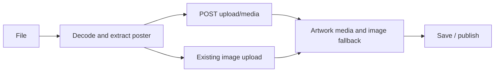

# Handoff: PR-99 / T-145a
## Builder notes
### What changed
GIF/MP4 artwork upload (4 MB) with signature/container checks; optional media/frameStyle schema; Object panel format choice, first-frame 1024 px poster extraction, muted looping preview, inline errors and Frame/TV controls. The image fallback is retained for plaque/2D use. Version stays 1. 3D playback belongs to T-145b.
Head: 1e288567. Branch: feat/T-145a-animated-art.
### Diagram

### How to test
- npm run lint: clean; npm test: 81 files, 644 passed; npm run build passed.
- E2E_BASE_URL=http://localhost:3145 npx playwright test tests/e2e/publish-view.spec.ts tests/e2e/edit-link.spec.ts --project=chromium: 2/2 passed.
- Real GIF and Chromium-generated AVC MP4 manual browser scripts passed: decode/poster/upload, Frame/TV save/publish/edit reload, media MIME, Range 206, nosniff. Scripts are temporary local verification artifacts, not committed app files.
- In Object panel, choose Animated, upload GIF or MP4 <=4 MB, choose TV, save, publish and reopen edit link. The viewer shows the poster until T-145b merges.
- API tests cover both GIF signatures, all five video brands, late moov after 64 KB, audio-only/invalid/forged input rejection, empty/missing/malformed uploads, 4 MB boundary and storage failures. Schema tests cover unchanged old galleries, media roundtrip and validation paths.
- Use PEGASUS_DATA_DIR outside the code checkout for local dev browser testing; the initial in-repo storage run repeatedly invalidated the dev server and failed before the editor loaded. After isolation, both required tests passed.
## Review rounds
## DevOps notes
Merge before T-145b. No merge performed by builder.
## DevOps notes
CI: ci + docs-guard + Vercel SUCCESS at 1e28856. Merge commit: d1abebdd54c5b2feebc05357241897d0ffcf899a (squash via devops gate, head pinned). Approved by reviewer-2 (00:08Z), review-approved. Pre-merge e2e on the PR preview: 7/8 then publish-view rerun 3/3 (first failure = the known intermittent publish-view flake, not attributed to this PR). Post-merge: prod d1abebd SUCCESS, live smoke 8/8. Release note: releases/CHANGELOG.md.
