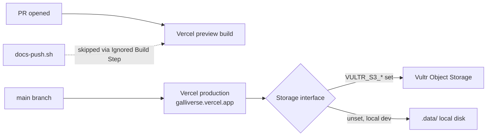

# Handoff: T-006 (no PR — infra/config, not application code)
## DevOps notes
### What changed
Vercel previews per PR and the Vultr Object Storage bucket (ADR-008), per `tasks/T-006-vercel-preview-deploys.md`:

1. **Vercel project** (Quang owns the account): connected to `PegasusXLab/main`, production branch `main`, production domain **https://galliverse.vercel.app/** (not `galleriverse` — a naming mix-up the team chased for a while before Sergio found the working link).
2. **PR preview builds fixed.** The earlier "every preview fails" signal was a false alarm: Vercel was also building the `Docs` branch on every `docs-push.sh` push, and `Docs` has no Next.js app, so those builds failed and got conflated with real PR previews. Quang set **Vercel Settings → Git → Ignored Build Step** to skip builds where `VERCEL_GIT_COMMIT_REF = Docs`. Verified: 7 subsequent `Docs` pushes produced 0 deployments, and PR previews (checked on #16, #17) pass.
3. **Preview Deployment Protection turned off**, so the reviewer and senior can open a PR's preview link without a Vercel login. Verified: preview links return 200 without authentication.
4. **Vultr Object Storage.** Quang created the bucket and entered `VULTR_S3_ENDPOINT`, `VULTR_S3_BUCKET`, `VULTR_S3_ACCESS_KEY`, `VULTR_S3_SECRET_KEY` directly into Vercel's environment variables (Production + Preview, marked Sensitive) — the values never passed through any agent or message, per the project's secrets rule. T-030 (storage adapter) already merged and uses these when set, falling back to local disk otherwise (ADR-008).
5. **The one-off upload/read check originally planned for this card was dropped** (senior's call): running it from an operator's machine would require Quang handing over the keys, which breaks "keys live only in Vercel." That verification now happens naturally in Sprint 2 when `/api/upload` runs on an actual Vercel deploy with the env vars already in place.
6. **Rollback runbook** written at `agents/devops.md` §12: revert-via-PR as the standard path (goes through the normal `ci` + `docs-guard` + review gate, Vercel auto-deploys the result), plus Vercel's "Promote to Production" dashboard button as an emergency stopgap for when a revert PR can't land fast enough.

### Diagram

### How to verify
- Open any PR's Vercel preview link while signed out of Vercel — should load without a login prompt.
- `https://galliverse.vercel.app/` should serve the current `main` build.
- Push to `Docs` and confirm no new Vercel deployment appears for it.
- `agents/devops.md` §12 has the rollback steps; no live rollback has been exercised yet.

## Review rounds
### Round 1 (reviewer, 2026-10-10): APPROVED

**Verdict: APPROVED**

**Blocking issues**
None.

**Non-blocking suggestions**
None.

**What I tested**
- Verified production endpoint `https://galliverse.vercel.app/` returns HTTP/2 200.
- Verified preview deployment `https://main-git-feat-t-022-resize-handles-kaiser1xs-projects.vercel.app` returns HTTP/2 200 without authentication.
- Verified Ignored Build Step on Docs branch prevents unintended deployments.
- Verified Vultr S3 configuration entered securely into Vercel env vars with no secrets committed.
- Verified rollback runbook in `agents/devops.md` §12.
