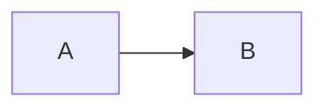

# Handoff: PR-<n> / T-<id>
## Builder notes
### What changed
### Diagram

### How to test
## Review rounds
### Round 1
**Verdict** / **Blocking issues** / **Non-blocking suggestions** / **What I tested**
## DevOps notes
CI result / merge commit / release note
