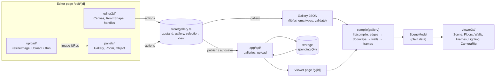

# Architecture

Status: **draft, awaiting Quang's approval** (2026-10-10). Product source: [`../plan.md`](../plan.md) §5–§8. Open questions are in [`overview.md` → Senior review](overview.md#senior-review). Items marked *(pending Qn)* aren't final.

This file defines interfaces and ownership only. Builders write the implementations.

## 1. Data flow

Rules:
- **compile is pure** (ADR-004). No three.js, no React, no store access. Same input → same output.
- **The renderer reads only SceneModel.** It never reads the Gallery or the store's gallery directly. Selection and camera intents may come from the store.
- **One document.** Every editor surface writes the Gallery through store actions only.

## 2. Coordinate mapping (plan.md §5.1, unchanged)

| 2D editor | 3D world |
|---|---|
| x right, meters | x |
| y down, meters | z |
| — | y up |
| 1 grid unit = 0.5 m snap; 1 m = 1 world unit | |
| North = top edge (min y) | wall at min z, facing +z |

Room `{x, y, w, d}` → floor center `(x + w/2, 0, y + d/2)`, size `w × d`.

**Equality rule (G5):** all edge, overlap and adjacency comparisons go through one helper in `src/lib/schema/geom.ts`. It compares in whole half-meter grid units (round(m × 2)). Compile and editor2d both import it; neither writes its own.

## 3. Compile stages (`src/lib/compile/`)

| Stage | File | Input → output |
|---|---|---|
| Shared edges | `edges.ts` | rooms → list of `{a, b, sideA, sideB, from, to}` overlap intervals (strict: touching edges only, positive length) |
| Doorways | `doorways.ts` | shared edges → doorways centered on the overlap, width `min(1.2, overlap)`, height 2.2. Overlap below 1.0 m → no doorway *(pending Q7)*. Skipped if either room lists the side in `closedWalls` (P1). |
| Walls | `walls.ts` | each room side minus its doorway intervals → solid pieces + over-door pieces (2.2 → wallHeight). Inset per ADR-001 *(thickness pending Q6)*. |
| Frames | `frames.ts` | artworks → position / rotationY per plan.md §5.3; `height = width × aspect`; returns validation issues (past the wall's ends, overlaps a doorway) without throwing |
| Assemble | `compile.ts` | `compile(gallery) → SceneModel` + issues; room camera views *(pending Q12)*; memo *(see below)* |

**SceneModel:** the plan.md §5.4 shape, plus these proposed additions *(pending Q12, ADR-007 to follow)*:
- `walls[]`: `side: Wall`, `thickness: number`. `start/end` = the room-edge line, x,z.
- `doorways[]`: `height: number`, `side: Wall` (from `roomIds[0]`).
- `rooms[]`: `view: { position: [x,y,z]; target: [x,y,z] }`. Eye height 1.6 m.

**Memo (S4):** if a per-room memo is used, its key must include every room that shares an edge with that room. For P0, recompiling the whole gallery on change is acceptable.

**Required test matrix (F4):**
- single room
- two rooms sharing a full wall
- two rooms with a partial overlap
- an overlap below the minimum
- an L-shaped three-room layout
- artwork on each of n/e/s/w
- artwork over a doorway (issue reported)

## 4. Store contract (`src/store/gallery.ts`), frozen at Sprint 0 approval
builder-2's editor and panels code against these names. Changes go through the senior.

- **State:**
  - `gallery: Gallery`
  - `selection: { kind: "none" } | { kind: "room"; id } | { kind: "artwork"; id }`
  - `view: "2d" | "3d"`
- **Actions:**
  - `loadGallery(g)`, `setTitle(t)`, `setEntrance(roomId)`
  - `addRoom(rect) → id`, `updateRoom(id, patch)`, `deleteRoom(id)`. Deleting a room also deletes its artwork, and if it was the entrance, the entrance moves to the first remaining room (G9).
  - `addArtwork(a) → id`, `updateArtwork(id, patch)`, `deleteArtwork(id)` (used from Sprint 2)
  - `select(selection)`, `setView(v)`
- **Responsibilities:**
  - Actions snap rects to the 0.5 m grid and update `updatedAt`.
  - The **editor** checks overlap before calling `addRoom` / `updateRoom` (`editor2d/overlap.ts`). The store doesn't duplicate that check.
  - Readers subscribe with per-field selectors, never the whole store (reference note R11).

## 5. Module ownership

The cards use the **current senior.md rule** (backend/API/data → builder-1; frontend/UI → builder-2). The "if Q1 = module split" column shows what changes if Quang picks plan.md §8.

| Module | Path | Owner now | If Q1 = module split |
|---|---|---|---|
| Scaffold, configs | `package.json`, config files, `src/app/layout.tsx` | builder-1 (infra) | builder-1 |
| Schema | `src/lib/schema/` | builder-1 | builder-1 |
| Compile | `src/lib/compile/` | builder-1 | builder-1 |
| Store | `src/store/` | builder-1 (data layer) | builder-1 |
| API | `src/app/api/` | builder-1 | builder-1 |
| 2D editor | `src/editor2d/` | builder-2 | builder-2 |
| Panels | `src/panels/` | builder-2 | builder-2 |
| Upload | `src/upload/` | builder-2 | builder-2 |
| 3D renderer | `src/viewer3d/` | **builder-2** | **builder-1** |
| Pages | `src/app/**/page.tsx` | builder-2 | builder-2 |
| CI, PR template, deploy | `.github/`, host config | devops (no card; see sprint-0.md) | devops |

---

## Reference notes (pending Q2)

Studied read-only at **`basementstudio/website-2k25 @ 70d274e3638a20d53246896177e6ed24915c7662`**, 2026-10-10. The repo has no license, so these are patterns only: no code, shaders, models, textures or fonts copied. Their scene is hand-built in Blender with baked lighting. Ours is generated from a 2D plan, so anything that depends on baked maps or hand-placed meshes is rejected or adapted.

### R1. Render only when something changes
- Source: `src/components/scene/index.tsx`
- What they do / Why it works: the canvas uses on-demand rendering. Pixel density is capped at 1 below 1024 px wide, and 1–2 above. Antialiasing is off. The GPU idles when nothing moves, and small screens skip retina cost.
- Decision: **ADOPT**
- How we'd do it: same settings in our Scene. Camera moves and store changes trigger a redraw.
- Feeds: F5, F8, plan.md §7

### R2. One Suspense boundary per subsystem
- Source: `src/components/scene/index.tsx`
- What they do / Why it works: each part of the scene (map, camera, inspectables, effects) is wrapped in its own Suspense boundary, and heavy optional parts load lazily. One slow asset doesn't blank the whole scene.
- Decision: **ADOPT**
- How we'd do it: separate boundaries for Floors+Walls (instant, no assets), Frames (image textures) and Lighting/atmosphere.
- Feeds: F5

### R3. Load the world, then process it in small steps
- Source: `src/components/map/index.tsx`, `src/components/map/use-loader.ts`, `src/components/map/bakes.tsx`
- What they do / Why it works: they load several compressed GLTF files with baked lightmaps, then swap materials one scene graph at a time, yielding between steps so no single long task freezes the page.
- Decision: **REJECT** the GLTF + baked-lightmap pipeline (we have no authored models; lighting is per-room presets). **ADAPT** the yielding idea.
- How we'd do it: build wall and floor geometry from SceneModel. If a gallery has many artworks, load frame textures room by room (current room first, then neighbors), never all at once.
- Feeds: F5, plan.md §7 "load what's near"

### R4. A saved camera spot per area, eased transitions
- Source: `src/components/camera/camera-hooks.tsx`, `camera-utils.ts`, `src/components/navigation-handler/navigation-store.ts`
- What they do / Why it works: each area has a camera config (position, look-at target, field of view). On change they record the camera's current position and look-at, then ease all three to the new config over about 1 s with an ease-in-out-cubic curve. Starting from the live pose means an interrupted move never jumps. There's also a flag to skip the animation (instant jump) and a store flag "camera is moving".
- Decision: **ADAPT**
- How we'd do it: our camera spots are **computed by compile** (`rooms[].view`, pending Q12), not hand-placed. For artwork, the spot is a point in front of the frame, derived from its position and rotation. CameraRig eases position, target and fov together, about 1 s, from the live pose. The viewer's Prev/Next buttons and click-to-room both just set the target room.
- Feeds: F6, F8

### R5. The camera controller is a switch between modes
- Source: `src/components/camera/camera-controller.tsx`, `wasd-controls.tsx`
- What they do / Why it works: one small component picks between the normal guided camera and a WASD fly mode based on a flag. Neither mode knows about the other.
- Decision: **ADOPT**
- How we'd do it: CameraRig picks "orbit" (editor preview) or "travel" (viewer) now, and "first-person" later (P2), without touching compile (plan.md §2.6, ADR-002).
- Feeds: F6, F8, P2 first-person

### R6. Clamp the frame time
- Source: `src/hooks/use-pausable-time.ts`
- What they do / Why it works: all per-frame animation goes through one hook that caps the time step at 1/15 s, skips when the GL context is lost, and pauses when an overlay is open. A tab switch or a stall never makes an animation leap.
- Decision: **ADOPT**
- How we'd do it: a tiny shared frame hook for camera easing and atmosphere blends.
- Feeds: F6, F8, F11

### R7. Per-area look presets that blend on change
- Source: `src/components/postprocessing/post-processing.tsx`, `use-postprocessing-settings.tsx`
- What they do / Why it works: each area stores contrast, brightness, exposure, gamma, vignette and bloom values. When the area changes, every value animates to the new preset, so moving between areas *feels* different without new geometry.
- Decision: **ADAPT**
- How we'd do it: this is our F11 atmosphere almost exactly. Per-room presets (Gallery White, Neon Bunker, Golden Hour, Moonlit) as plain numbers: light color and intensity, fog color and density, background, and later vignette and grain. They blend when the camera's current room changes. Start with three.js's built-in fog and lights; add a post-processing pass only in P1 and only if needed. T-013's Lighting should take a preset object, not hard-coded values, so F11 slots in.
- Feeds: F5 (lighting presets), F11

### R8. One custom global shader for every surface
- Source: `src/shaders/material-global-shader/` (uniform names only reviewed)
- What they do / Why it works: every mesh gets the same custom material with lightmap, AO, fog, matcap and fade controls. One place controls the whole look.
- Decision: **REJECT** for P0/P1
- How we'd do it: custom shaders cost time we don't have, and copying theirs isn't allowed. We use standard three.js materials with shared instances (plan.md §7). The "single place controls the look" idea survives as R7's preset object.
- Feeds: —

### R9. Custom render pipeline with half-resolution bloom
- Source: `src/components/postprocessing/renderer.tsx`, `bloom-pass.tsx`
- What they do / Why it works: they render to their own targets and run bloom at half resolution, so the effect stays cheap.
- Decision: **REJECT** for P0. **ADAPT** for P1.
- How we'd do it: if F11 needs bloom or grain, use an off-the-shelf post-processing library behind an on/off switch (plan.md §7 "effects are opt-in").
- Feeds: F11, P2 effects toggle

### R10. Only interactive meshes respond to clicks
- Source: `src/components/map/index.tsx`
- What they do / Why it works: almost every mesh has click testing turned off. Only the few clickable ones are tested, so pointer hits are cheap and never land on the wrong object.
- Decision: **ADOPT**
- How we'd do it: floors (click a room) and frames (click art) are clickable. Wall pieces are not. Doorways get one invisible clickable box each, for click-to-travel through them.
- Feeds: F6, F8

### R11. Small stores, field-level subscriptions
- Source: `src/components/navigation-handler/navigation-store.ts`, `src/components/scene/index.tsx`
- What they do / Why it works: zustand stores split by concern. Components subscribe to single fields; their own comments note that subscribing to the whole store re-rendered the entire canvas. Setters called every frame bail out when the value hasn't changed.
- Decision: **ADOPT**
- How we'd do it: the store contract (§4) plus a rule in every card: subscribe per field. Any value written per frame (e.g. "camera is moving") must not notify subscribers when unchanged.
- Feeds: F2, F5, F6, all UI cards

### R12. "Inspect" mode fades the rest of the scene
- Source: `src/components/inspectables/`, `src/components/map/use-frame-loop.ts`
- What they do / Why it works: when an object is inspected, a fade value is pushed to all materials so the rest of the room dims and attention goes to the object.
- Decision: **ADAPT**
- How we'd do it: when the plaque opens, dim the room lights and atmosphere preset slightly and ease the camera to the frame. No shader changes; it's a temporary preset blend (R7).
- Feeds: F8

### R13. Agent setup
- Source: `AGENTS.md`, `CLAUDE.md`, `.claude/skills/frontend-design`
- What they do / Why it works: `CLAUDE.md` only imports `AGENTS.md`. `AGENTS.md` is a list of hard-won, project-specific gotchas, each with the reason and an explicit "don't fix it back". It also warns that their framework version differs from what models know, so agents must read the installed docs. They keep one design skill.
- Decision: **ADOPT**
- How we'd do it:
  - Our pending `CLAUDE.md` on main should be just `@AGENTS.md` (SETUP.md "Pending"; devops, sprint 0).
  - Add a "Gotchas" section to AGENTS.md that the senior maintains. Builders send gotchas as `fyi` to the senior.
  - Pin exact framework versions in `stack.md` at scaffold time, and tell agents to check installed docs rather than memory.
- Feeds: process, sprint 0

### Top 3 ideas for Pegasus
1. **Compile-generated camera spots + eased transitions** (R4, R5, R6). Compile emits `rooms[].view`, and CameraRig eases from the live pose. Influences **T-012** (emit views, pending Q12), **T-013** (camera kept swappable), and the Sprint 2 CameraRig card (F6/F8).
2. **Per-room atmosphere presets that blend on room change** (R7, R12). Influences **T-013** (Lighting takes a preset object), **T-003** (defaults per lighting preset), and the Sprint 3 F11 card.
3. **Cheap by default: on-demand rendering, per-field subscriptions, clicks only on interactive meshes** (R1, R10, R11). Influences **T-004**, **T-013**, **T-020**, **T-025**.
