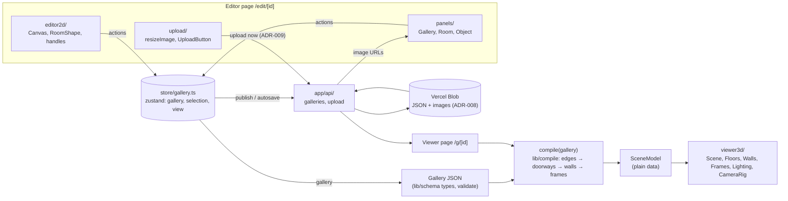

# Architecture

Status: **decisions approved by Quang (Q1–Q12), 2026-10-10**; the store contract (§4) freezes when T-004 merges. Product source: [`../plan.md`](../plan.md) §5–§8. Decisions: `decisions/ADR-001` to `ADR-009`.

This file defines interfaces and ownership only. Builders write the implementations.

## 1. Data flow

Rules:
- **compile is pure** (ADR-004). No three.js, no React, no store access. Same input → same output.
- **The renderer reads only SceneModel.** It never reads the Gallery or the store's gallery directly. Selection and camera intents may come from the store.
- **One document.** Every editor surface writes the Gallery through store actions only.

## 2. Coordinate mapping (plan.md §5.1, unchanged)

| 2D editor | 3D world |
|---|---|
| x right, meters | x |
| y down, meters | z |
| — | y up |
| 1 grid unit = 0.5 m snap; 1 m = 1 world unit | |
| North = top edge (min y) | wall at min z, facing +z |

Room `{x, y, w, d}` → floor center `(x + w/2, 0, y + d/2)`, size `w × d`.

**Equality rule (G5):** all edge, overlap and adjacency comparisons go through one helper in `src/lib/schema/geom.ts`. It compares in whole half-meter grid units (round(m × 2)). Compile and editor2d both import it; neither writes its own.

## 3. Compile stages (`src/lib/compile/`)

| Stage | File | Input → output |
|---|---|---|
| Shared edges | `edges.ts` | rooms → list of `{a, b, sideA, sideB, from, to}` overlap intervals (strict: touching edges only, positive length) |
| Doorways | `doorways.ts` | shared edges → doorways centered on the overlap, width `min(1.2, overlap)`, height 2.2. Overlap below 1.0 m → no doorway (ADR-007). Skipped if either room lists the side in `closedWalls` (P1). |
| Walls | `walls.ts` | each room side minus its doorway intervals → solid pieces + over-door pieces (2.2 → wallHeight). Each piece 0.075 m thick from the room edge inward (ADR-001). |
| Frames | `frames.ts` | artworks → position / rotationY per plan.md §5.3; `height = width × aspect`; returns validation issues (past the wall's ends, overlaps a doorway) without throwing |
| Assemble | `compile.ts` | `compile(gallery) → SceneModel` + issues; room camera views (ADR-007); memo (see below) |

**SceneModel:** the plan.md §5.4 shape, plus these additions (ADR-007):
- `walls[]`: `side: Wall`, `thickness: number`. `start/end` = the room-edge line, x,z.
- `doorways[]`: `height: number`, `side: Wall` (from `roomIds[0]`).
- `rooms[]`: `view: { position: [x,y,z]; target: [x,y,z] }`. Eye height 1.6 m.

**Viewer room order (Q8, ADR-007):** Previous/Next = breadth-first from the entrance through doorways, ties broken by document order, unconnected rooms last.

**Memo (S4):** if a per-room memo is used, its key must include every room that shares an edge with that room. For P0, recompiling the whole gallery on change is acceptable.

**Required test matrix (F4):**
- single room
- two rooms sharing a full wall
- two rooms with a partial overlap
- an overlap below the minimum
- an L-shaped three-room layout
- artwork on each of n/e/s/w
- artwork over a doorway (issue reported)

## 4. Store contract (`src/store/gallery.ts`), frozen at Sprint 0 approval
builder-2's editor and panels code against these names. Changes go through the senior.

- **State:**
  - `gallery: Gallery`
  - `selection: { kind: "none" } | { kind: "room"; id } | { kind: "artwork"; id }`
  - `view: "2d" | "3d"`
- **Actions:**
  - `loadGallery(g)`, `setTitle(t)`, `setEntrance(roomId)`
  - `addRoom(rect) → id`, `updateRoom(id, patch)`, `deleteRoom(id)`. Deleting a room also deletes its artwork, and if it was the entrance, the entrance moves to the first remaining room (G9).
  - `addArtwork(a) → id`, `updateArtwork(id, patch)`, `deleteArtwork(id)` (used from Sprint 2)
  - `select(selection)`, `setView(v)`
- **Responsibilities:**
  - Actions snap rects to the 0.5 m grid and update `updatedAt`.
  - The **editor** checks overlap before calling `addRoom` / `updateRoom` (`editor2d/overlap.ts`). The store doesn't duplicate that check.
  - Readers subscribe with per-field selectors, never the whole store (reference note R11).

## 5. Module ownership

Split by module (ADR-005, Quang Q1). Within a module, each card still lists its exact files.

| Module | Path | Owner |
|---|---|---|
| Scaffold, configs, `.gitignore`, README | `package.json`, config files, `src/app/layout.tsx`, `src/app/page.tsx` placeholder | builder-1 |
| Schema | `src/lib/schema/` | builder-1 |
| Compile | `src/lib/compile/` | builder-1 |
| Store | `src/store/` | builder-1 |
| API | `src/app/api/` | builder-1 |
| 3D renderer / viewer | `src/viewer3d/`, `src/app/g/[id]/page.tsx` | builder-1 |
| 2D editor | `src/editor2d/` | builder-2 |
| Panels | `src/panels/` | builder-2 |
| Upload | `src/upload/` | builder-2 |
| Shared layout components | `src/components/` | builder-2 |
| Editor and start pages | `src/app/edit/[id]/page.tsx`, start screen (Sprint 2) | builder-2 |
| CI, PR template, repo setup, deploy | `.github/`, `CLAUDE.md`, `.env.example`, Vercel config | devops |

---

## Reference notes
Moved to [`reference-basement.md`](reference-basement.md) (Q2 approved). Cards cite patterns as R1–R13.
