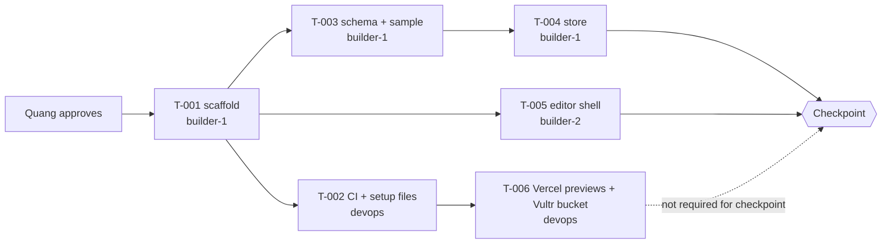

# Sprint 0: Foundation

Status: **planning**. Decisions Q1–Q12 answered (plan/overview.md → Decisions). Cards go `ready` once Quang approves the breakdown. Hours 0–2 (plan.md §10). Clock times TBD: the hacking period isn't set yet (Q5).

## Goal
Plan approved, schema frozen, app scaffolded, CI green. Everything is built and verified locally; hosted previews at https://galleriverse.vercel.app/ come with T-006.
**Checkpoint:** the hardcoded 3-room sample JSON exists on `main` and passes validation in CI and locally.

## Order of work
1. Quang approves the breakdown. The senior marks the Sprint 0 cards `ready` and sends assignments.
2. **T-001 scaffold** (builder-1). Everything else waits for this merge.
3. In parallel once T-001 merges:
   - builder-1: **T-003 schema + sample** → **T-004 store**
   - builder-2: **T-005 editor shell**
   - devops: **T-002 CI + PR template + setup files** → **T-006 (Vercel previews + Vultr bucket)**. Quang already connected Vercel at https://galleriverse.vercel.app/; T-006 is not required for the Sprint 0 checkpoint
4. Checkpoint check by the senior.

Merge order hint for devops: T-002 should merge right after T-001, so every later PR gets CI.

## Checkpoint: how to verify (senior)
- `main` has T-001 to T-005 merged with green CI (T-006 may still be finishing).
- The CI log shows `sample-3room.json` passing `validate` and the store test loading it.
- Locally, on a fresh clone of `main`: `npm ci`, `npm run lint`, `npm run typecheck`, `npm test` all pass, and `npm run dev` shows the placeholder page at http://localhost:3000.
- Report pass/fail to Quang.

## Tickets
| ID | Title | Assignee | depends_on |
|---|---|---|---|
| T-001 | Scaffold Next.js app with lint and unit tests | builder-1 | — |
| T-002 | CI on PRs, PR template and the pending repo-setup files | devops | T-001 |
| T-003 | Schema, defaults, validation, geom helper, sample | builder-1 | T-001 |
| T-004 | Gallery store with the frozen contract | builder-1 | T-003 |
| T-005 | Editor shell layout component | builder-2 | T-001 |
| T-006 | Vercel previews per PR, Vultr Object Storage bucket | devops | T-002 |

## Per agent

### builder-1 (Vic)
- **Owns this sprint:** T-001, T-003, T-004.
- **Files:** root configs, `package.json`, `.gitignore`, `README.md`, `src/app/layout.tsx`, `src/app/page.tsx`, `src/app/globals.css`, `src/lib/schema/*`, `src/fixtures/*`, `public/fixtures/*`, `src/store/*`.
- **Read:** plan.md §5.1, §6, §8; plan/stack.md; plan/architecture.md §2, §4, §5; plan/overview.md G1–G5, G8, G9; ADR-004, ADR-005.
- **Reference patterns** (plan/reference-basement.md): R11 (per-field store subscriptions, bail-out setters), R13 (pin versions, read the installed docs), R7 (lighting presets as data, T-003).
- **Watch out:** the store contract (architecture.md §4) is what builder-2 codes against. Don't rename or reshape it; ask the senior first.
- **Next sprint:** compile T-010 to T-012 and the renderer T-013 (module split, ADR-005).

### builder-2 (Parth)
- **Owns this sprint:** T-005.
- **Files:** `src/components/EditorShell.tsx` only.
- **Read:** plan.md §2, §3 (all wireframes), §4 F1–F2, §8; plan/architecture.md §1, §4 (the store contract you'll use in Sprint 1), §5; ADR-005.
- **Reference patterns:** R11 (per-field subscriptions; applies from Sprint 1).
- **Prepare for Sprint 1:** read the drafts T-020 to T-025. The renderer (T-013) is builder-1's under the module split; you import its `Scene` in T-025. Send the senior a `question` if anything is unclear.
- **Touch support** is a stretch feature (Q10). Mouse only for now.

### reviewer (Vic)
- **Owns this sprint:** reviews of T-001 to T-006.
- **Read:** plan/architecture.md §2, §4, §5; the acceptance criteria on each card; plan.md §6; ADR-008.
- **Focus:**
  - T-001: pinned versions; `.gitignore` covers `.env*`; nothing secret committed.
  - T-002: CI runs lint, typecheck and tests; `.env.example` has names only.
  - T-003: the schema matches plan.md §6 exactly; geom is the only comparison helper.
  - T-004: action names match architecture.md §4.
  - T-006: no token in the repo or logs.
- **Note:** you share an operator with builder-1. Never review in the session that built the PR (AGENTS.md).
- **Reference patterns:** none specific this sprint.

### devops (Sergio)
- **Owns this sprint:** **T-002** (CI, PR template, `CLAUDE.md`, docs-guard, `.env.example`) and **T-006** (Vercel previews, Vultr bucket + keys, rollback runbook). Quang connected Vercel (https://galleriverse.vercel.app/) and is giving you access. Merging and CI health for every PR, as usual.
- **How:** you can now hold cards. Follow agents/devops.md §7 step 9 (builder flow for your own cards); your PRs are reviewed by the reviewer.
- **Files:** `.github/**`, `CLAUDE.md`, `.env.example`, `vercel.json` (if needed), agents/devops.md §12. Not `.gitignore` (T-001).
- **Read:** plan/stack.md (Hosting), ADR-008, agents/SETUP.md "Pending", agents/devops.md.
- **T-006:** start after T-002. Quang owns both the Vercel and Vultr accounts; ask him through `team/human/inbox/` (needs-human) for the Vultr bucket and key step. Vultr GPU servers are on hold.
- **Reference patterns:** R13 (`CLAUDE.md` = `@AGENTS.md`).

## Retro

**Checkpoint: PASS** (senior, 2026-10-10T09:06Z): fresh clone of `main` at `719cdac`. `npm ci`, lint and typecheck passed; tests 82/82 (the sample fixture validates and loads into the store); `npm run dev` serves the placeholder page; CI green on all four Sprint 0 merges.

**Completed:** T-001 (PR #1, 2 rounds), T-002 (PR #4), T-003 (PR #2, 2 rounds), T-004 (PR #6, 1 round), T-005 (PR #3).
**Carried over:** T-006 (Vercel previews + Vultr bucket). It's not needed for the checkpoint, and it waits on Quang's Vultr bucket/key step; it moves to Sprint 1.

**Went well:**
- The review loop worked without humans: T-001 was built, reviewed, fixed and re-approved in about 6 minutes.
- builder-1's gotcha reports (Next writes its own AGENTS.md; CLAUDE.md import path) were caught before they landed.

**Problems:**
- devops and builder-2 started late (builder-2 ran outdated local script copies).
- No CI existed for the first merge (one-time exception, ADR-010).
- The shared GitHub account rules out GitHub approvals (ADR-010).
- The ruleset first targeted all branches; it was caught before activation.

**Lessons for Sprint 1:**
- Every operator keeps a looping session.
- Use only the shared scripts.
- Run done.sh after every handled message, so stall detection works.
- Summaries: builder-1's is filled in; builder-2, reviewer and devops were asked to fill theirs.
