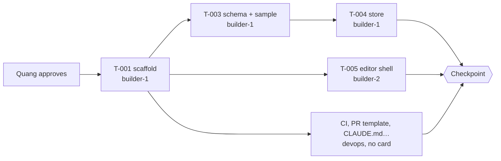

# Sprint 0: Foundation

Status: **planning**. No card is `ready` until Quang approves (see plan/overview.md → Senior review). Hours 0–2 (plan.md §10).

## Goal
Plan approved, schema frozen, app scaffolded, CI green.
**Checkpoint:** the hardcoded 3-room sample JSON exists on `main` and passes validation.

## Order of work
1. **Quang answers Q1–Q12** (plan/overview.md §5). The senior updates cards, ADRs and the architecture, then marks the Sprint 0 cards `ready` and sends assignments.
2. **T-001 scaffold** (builder-1). Everything else waits for this merge.
3. In parallel once T-001 merges:
   - builder-1: **T-003 schema + sample** → **T-004 store**
   - builder-2: **T-005 editor shell**
   - devops: CI + PR template + pending main files (below)
4. Checkpoint check by the senior.

## Checkpoint: how to verify (senior)
- `main` has T-001, T-003, T-004 and T-005 merged with green CI.
- `src/fixtures/sample-3room.json` passes `validate` in the test run (CI log).
- The store test loads the fixture.
- The preview deploy shows the placeholder page (if Q4 is answered).

## Tickets
| ID | Title | Assignee | depends_on |
|---|---|---|---|
| T-001 | Scaffold Next.js app with lint and unit tests | builder-1 | — |
| T-003 | Schema, defaults, validation, geom helper, sample | builder-1 | T-001 |
| T-004 | Gallery store with the frozen contract | builder-1 | T-003 |
| T-005 | Editor shell layout component | builder-2 | T-001 |

T-002 is reserved for the devops card if Q11 is approved.

## Per agent

### builder-1 (Vic)
- **Owns this sprint:** T-001, T-003, T-004.
- **Files:** root configs, `package.json`, `src/app/layout.tsx`, `src/app/page.tsx`, `src/app/globals.css`, `README.md`, `src/lib/schema/*`, `src/fixtures/*`, `public/fixtures/*`, `src/store/*`.
- **Read:** plan.md §5.1, §6, §8; plan/stack.md; plan/architecture.md §2, §4, §5; plan/overview.md G1–G5, G8, G9; ADR-004.
- **Reference patterns** (plan/architecture.md "Reference notes"): R11 (per-field store subscriptions, bail-out setters), R13 (pin versions, read the installed docs), R7 (lighting presets as data, T-003).
- **Watch out:** the store contract (architecture.md §4) is what builder-2 codes against. Don't rename or reshape it; ask the senior first.

### builder-2 (Parth)
- **Owns this sprint:** T-005.
- **Files:** `src/components/EditorShell.tsx` only.
- **Read:** plan.md §2, §3 (all wireframes), §4 F1–F2, §8; plan/architecture.md §1, §4 (the store contract you'll use in Sprint 1), §5; ADR-005.
- **Reference patterns:** R11 (per-field subscriptions; applies from Sprint 1).
- **Prepare for Sprint 1:** read the T-020 to T-025 drafts and T-013 (the renderer; assigned to you under the current lane rule, may move to builder-1 after Q1). Send the senior a `question` if anything is unclear.

### reviewer (Vic)
- **Owns this sprint:** reviews of T-001, T-003, T-004, T-005.
- **Read:** plan/architecture.md §2, §4; the acceptance criteria on each card; plan.md §6.
- **Focus:**
  - T-001: pinned versions, nothing secret committed, no CI files (devops owns them).
  - T-003: the schema matches plan.md §6 exactly, and geom is the only comparison helper.
  - T-004: action names match architecture.md §4.
- **Note:** you share an operator with builder-1. Never review in the session that built the PR (AGENTS.md).
- **Reference patterns:** none specific this sprint.

### devops (Sergio)
- **Owns this sprint (no card until Q11; track it in your own log under T-000):**
  1. CI on PRs to `main`: install, lint, typecheck, unit tests. Required check for branch protection.
  2. `.github/pull_request_template.md` (sections in agents/builder.md §8).
  3. Restore the SETUP.md "Pending" files from reverted commit `867d992`: `CLAUDE.md` (just `@AGENTS.md`, reference note R13), `.github/workflows/docs-guard.yml`, `.gitignore`, `.env.example`.
  4. Preview deploys once Q4 (hosting) is answered.
  5. Fill in the rollback runbook in agents/devops.md §12 once the host is chosen.
- **Order:** start right after T-001 merges (CI needs `package.json` scripts). Open as small PRs; the reviewer reviews them.
- **Files:** `.github/**`, `CLAUDE.md`, `.gitignore`, `.env.example`, host config. No card may touch these.
- **Read:** plan/stack.md (Hosting), agents/SETUP.md "Pending", plan/overview.md C3, C6, Q4, Q11.
- **Reference patterns:** R13 (CLAUDE.md = `@AGENTS.md`).

## Retro
(written by the senior at sprint end from every `sprint-0/summary.md`)
