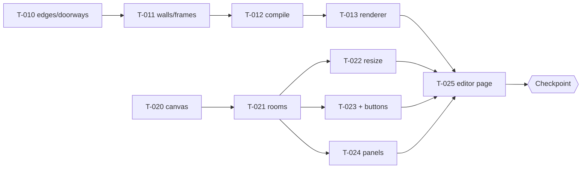

# Sprint 1: Editor + compile

Status: **planning** (starts with `scripts/new-sprint.sh 1` after the Sprint 0 checkpoint passes). Hours 2–12 (plan.md §10). All cards are `draft` until Quang approves.

## Goal
2D editor (F1, F2) and the compile step with tests (F4); the renderer draws the compiled sample (F5).
**Checkpoint:** build 3 rooms in 2D → toggle → see them in 3D, with doorways.

## Parallel lanes
Both lanes meet only at two frozen contracts: the **store** (T-004, architecture.md §4) and the **SceneModel** (T-012, architecture.md §3).

| Lane A: compile (builder-1) | Lane B: editor (builder-2) |
|---|---|
| T-010 edges + doorways | T-020 canvas + grid |
| T-011 walls + frames | T-021 rooms: add/select/move/delete |
| T-012 compile() + SceneModel | T-022 resize handles · T-023 "+" buttons · T-024 panels |
| | T-013 renderer (after T-012; see Q1) |
| | **T-025 editor page: integration** |

## Order of work
1. Both lanes start at once. Lane A has no UI dependency; lane B uses the store and the T-005 shell.
2. Under the current lane rule, builder-2 picks up T-013 as soon as T-012 merges and works on editor cards until then. If Q1 = module split, T-013 belongs to builder-1 and runs right after T-012 in lane A.
3. T-022 / T-023 / T-024 can run in any order after T-021.
4. T-025 last: it only wires the merged pieces together.

**Integration risk control:**
- Neither lane changes the store or SceneModel contracts without a `question` to the senior.
- If T-025 slips, the fallback demo for the checkpoint is T-013 rendering `sample-3room.json`.

## Checkpoint: how to verify (senior)
On the preview deploy of `main` after T-025 merges:
1. Open `/edit/local`.
2. From the sample (or blank), add rooms with the "+" buttons until there are 3 connected rooms.
3. Change one room's wall color and size in the panel.
4. Toggle to 3D: 3 rooms visible, walls in the right colors, doorway gaps on every shared wall ≥ 1 m.
5. While in 3D, change a width in the panel: the scene updates.
6. The CI log shows the F4 matrix passing.

Pass/fail is reported to Quang with screenshots.

## Tickets
| ID | Title | Assignee | depends_on |
|---|---|---|---|
| T-010 | Compile: shared edges and doorways | builder-1 | T-003 |
| T-011 | Compile: wall segments and frame placement | builder-1 | T-010 |
| T-012 | compile() assembly, SceneModel, F4 matrix | builder-1 | T-011 |
| T-013 | 3D renderer: Scene, Floors, Walls, Lighting | builder-2 (Q1 → builder-1) | T-012 |
| T-020 | 2D canvas: grid, pan, zoom | builder-2 | T-004, T-005 |
| T-021 | Rooms: add, select, move, delete, snapping, overlap | builder-2 | T-020 |
| T-022 | Resize handles | builder-2 | T-021 |
| T-023 | "+" add-adjacent-room buttons | builder-2 | T-021 |
| T-024 | Gallery and Room panels | builder-2 | T-004, T-005, T-021 |
| T-025 | Editor page with 2D / 3D toggle | builder-2 | T-013, T-021–T-024 |

## Per agent

### builder-1 (Vic)
- **Owns:** T-010, T-011, T-012 (and T-013 if Q1 = module split).
- **Files:** `src/lib/compile/*` (and `src/viewer3d/{Scene,Floors,Walls,Lighting}.tsx` if Q1 = module split).
- **Read:** plan.md §5 (all of it); plan/architecture.md §2, §3; ADR-001, ADR-004; plan/overview.md G1–G7, S1–S4, Q6, Q7, Q12.
- **Reference patterns:** R4 (camera spots as data: `rooms[].view`, T-012). Top idea 1.

### builder-2 (Parth)
- **Owns:** T-013 (unless Q1 moves it), T-020 to T-025.
- **Files:**
  - `src/editor2d/{Canvas,Grid,RoomShape,ResizeHandles,AddRoomButtons}.tsx`
  - `src/editor2d/{snapping,overlap}.ts` + tests
  - `src/panels/{GalleryPanel,RoomPanel}.tsx`
  - `src/viewer3d/{Scene,Floors,Walls,Lighting}.tsx`
  - `src/app/edit/[id]/page.tsx`
- **Read:** plan.md §3.2, §3.4, §4 F1, F2, F5, §7; plan/architecture.md §1, §2, §4; ADR-002; plan/overview.md G5, G8–G10.
- **Reference patterns:**
  - R1 (render on demand, pixel-density cap; T-013, T-025)
  - R2 (Suspense per subsystem; T-013)
  - R7 (Lighting takes a preset object; T-013)
  - R10 (only floors clickable; T-013)
  - R11 (per-field store subscriptions; every editor card)
- **Rule:** `snapping.ts` / `overlap.ts` are edited only under T-021. Other cards import them.

### reviewer (Vic)
- **Owns:** reviews of all Sprint 1 PRs.
- **Read:** plan/architecture.md §2–§4; plan.md §5; each card's acceptance criteria.
- **Focus:**
  - Compile PRs: pure (no three/React imports); every F4 matrix case present; geometry checked against hand-computed numbers.
  - Editor PRs: touching rooms allowed, overlap refused; store used only through the contract.
  - T-013: reads SceneModel only; disposes geometry; render on demand.
  - UAT T-025 with the checkpoint steps above (Playwright where possible).
- **Reference patterns:** R1, R10, R11 as review checks for T-013 / T-025.

### devops (Sergio)
- **Owns:** CI health, one-at-a-time merges, preview deploys per PR (if Q4 is answered), `releases/CHANGELOG.md`, the merge-order heads-up (T-021 before T-022/T-023/T-024; T-012 before T-013).
- **Files:** `.github/**`, host config.
- **Read:** this file's dependency diagram; agents/devops.md.
- **Reference patterns:** none.

## Retro
(written by the senior at sprint end from every `sprint-1/summary.md`)
