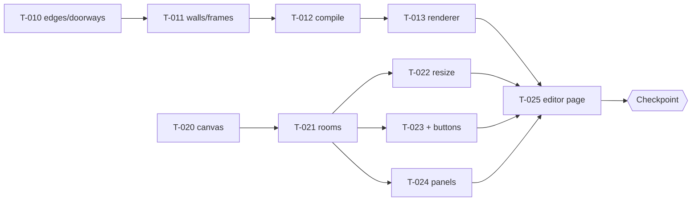

# Sprint 1: Editor + compile

Status: **planning** (starts with `scripts/new-sprint.sh 1` after the Sprint 0 checkpoint passes). Hours 2–12 (plan.md §10); clock times TBD (Q5). Cards go `ready` once Quang approves the breakdown.

## Goal
2D editor (F1, F2) and the compile step with tests (F4); the renderer draws the compiled gallery (F5).
**Checkpoint:** build 3 rooms in 2D → toggle → see them in 3D, with doorways.

## Parallel lanes (module split, ADR-005)
Both lanes meet only at two frozen contracts: the **store** (T-004, architecture.md §4) and the **SceneModel** + `<Scene>` props (T-012 / T-013, architecture.md §3).

| Lane A: compile → render (builder-1) | Lane B: editor (builder-2) |
|---|---|
| T-010 edges + doorways | T-020 canvas + grid |
| T-011 walls + frames | T-021 rooms: add/select/move/delete |
| T-012 compile() + SceneModel | T-022 resize handles · T-023 "+" buttons · T-024 panels |
| T-013 renderer | **T-025 editor page: integration** |

## Order of work
1. Both lanes start at once. Lane A has no UI dependency; lane B uses the store (T-004) and the shell (T-005).
2. builder-1 develops T-013 against `sample-3room.json` compiled with T-012, so the renderer is ready before the editor is.
3. T-022 / T-023 / T-024 can run in any order after T-021.
4. T-025 last: it only wires merged pieces together (editor page + lazy-loaded `<Scene>`).

**Integration risk control:**
- Neither lane changes the store or SceneModel contracts without a `question` to the senior.
- If T-025 slips, the checkpoint fallback is T-013 rendering `sample-3room.json` locally.

## Checkpoint: how to verify (senior)
Locally, on a fresh clone of `main` after T-025 merges (`npm ci`, then `npm run dev`, http://localhost:3000). Repeat on the preview URL once Quang provides Vercel:
1. Open `/edit/local`.
2. Add rooms with the "+" buttons until there are 3 connected rooms.
3. Change one room's wall color and size in the panel.
4. Toggle to 3D: 3 rooms visible, walls in the right colors, doorway gaps on every shared wall ≥ 1 m.
5. While in 3D, change a width in the panel: the scene updates.
6. The CI log shows the F4 matrix passing.

Pass/fail is reported to Quang with screenshots.

## Tickets
| ID | Title | Assignee | depends_on |
|---|---|---|---|
| T-010 | Compile: shared edges and doorways | builder-1 | T-003 |
| T-011 | Compile: wall segments and frame placement | builder-1 | T-010 |
| T-012 | compile() assembly, SceneModel, F4 matrix | builder-1 | T-011 |
| T-013 | 3D renderer: Scene, Floors, Walls, Lighting | builder-1 | T-012 |
| T-020 | 2D canvas: grid, pan, zoom | builder-2 | T-004, T-005 |
| T-021 | Rooms: add, select, move, delete, snapping, overlap | builder-2 | T-020 |
| T-022 | Resize handles | builder-2 | T-021 |
| T-023 | "+" add-adjacent-room buttons | builder-2 | T-021 |
| T-024 | Gallery and Room panels | builder-2 | T-004, T-005, T-021 |
| T-025 | Editor page with 2D / 3D toggle | builder-2 | T-013, T-021 to T-024 |

## Per agent

### builder-1 (Vic)
- **Owns:** T-010, T-011, T-012, T-013.
- **Files:** `src/lib/compile/*`, `src/viewer3d/{Scene,Floors,Walls,Lighting}.tsx`.
- **Read:** plan.md §5 (all of it), §7; plan/architecture.md §2, §3; ADR-001, ADR-002, ADR-004, ADR-007; plan/overview.md G1–G7, S1–S4.
- **Reference patterns:**
  - R4 (camera spots as data: `rooms[].view`, T-012; Top idea 1)
  - R1 (render on demand, pixel-density cap), R2 (Suspense per subsystem), R7 (Lighting takes a preset object; Top idea 2), R10 (only floors clickable), all for T-013

### builder-2 (Parth)
- **Owns:** T-020 to T-025.
- **Files:**
  - `src/editor2d/{Canvas,Grid,RoomShape,ResizeHandles,AddRoomButtons}.tsx`
  - `src/editor2d/{snapping,overlap}.ts` + tests
  - `src/panels/{GalleryPanel,RoomPanel}.tsx`
  - `src/app/edit/[id]/page.tsx`
- **Read:** plan.md §3.2, §3.4, §4 F1, F2; plan/architecture.md §1, §2, §4; plan/overview.md G5, G8–G10.
- **Reference patterns:** R11 (per-field store subscriptions; every card); R1 (lazy-load the 3D canvas in T-025).
- **Rules:**
  - `snapping.ts` / `overlap.ts` are edited only under T-021; other cards import them.
  - In T-025, import `<Scene>` from `src/viewer3d/` and don't edit it.
- Touch is a stretch feature (Q10). Mouse only.

### reviewer (Vic)
- **Owns:** reviews of all Sprint 1 PRs.
- **Read:** plan/architecture.md §2–§4; plan.md §5; ADR-007; each card's acceptance criteria.
- **Focus:**
  - Compile PRs: pure (no three/React imports); every F4 matrix case present; numbers checked by hand (0.075 m walls, 1.0 m doorway minimum, 0.08 m frames).
  - Editor PRs: touching rooms allowed, overlap refused; store used only through the contract.
  - T-013: reads SceneModel only; disposes geometry; render on demand.
  - UAT T-025 with the checkpoint steps above (Playwright where possible).
- **Load warning:** builder-1 (also Vic) has four cards this sprint. Review builder-2's PRs promptly so lane B isn't blocked while Vic is building.
- **Reference patterns:** R1, R10, R11 as review checks for T-013 / T-025.

### devops (Sergio)
- **Owns:** CI health, one-at-a-time merges, `releases/CHANGELOG.md`; preview deploys once T-006 is unblocked. Merge-order heads-up: T-021 before T-022 / T-023 / T-024; T-012 before T-013; T-025 last.
- **Files:** `.github/**`, Vercel config.
- **Read:** this file's dependency diagram; agents/devops.md.
- **Reference patterns:** none.

## Retro

**Checkpoint: PASS** (senior, 2026-10-10T11:52Z), fresh clone of `main` at `e7cbb84`:
- `npm ci`, lint and typecheck pass; unit tests 222/222.
- Driven in a real browser (Playwright, own dev server):
  - `/edit/local` loads the 3-room sample.
  - "+" added a 4th connected room, and the wall color edit round-trips.
  - Toggling to 3D renders all 4 rooms, with the new room in its new color and doorway gaps visible on the shared walls.
  - No page errors. The only console warnings are `THREE.Clock` deprecated (library) and GPU-stall messages from the screenshot capture.

**Follow-up:** builder-3's `tests/e2e/editor.spec.ts` assumes `/edit/local` starts empty, but it starts with the sample (T-004 design), so its first assertion fails. builder-3 fixes the spec as the last step of T-050 (enable it, starting from the sample).

**Completed:** T-020 to T-025, T-010 to T-013, T-007, plus Sprint 0's T-006 (carried over).

**Went well:**
- builder-1's compile lane finished early, so Sprint 2 server/3D work started in parallel.
- Second and third reviewers (ADR-011, ADR-012) removed the review bottleneck.
- The Vercel Docs-branch build failures were diagnosed and fixed.

**Problems:**
- Stacked PR #11 was auto-closed.
- `Canvas.tsx` was edited by several cards (fixed by sequencing).
- Vic's sessions stalled once and moved to Antigravity.
- The Vultr upload returns 500 (`TypeError`), still being diagnosed.
