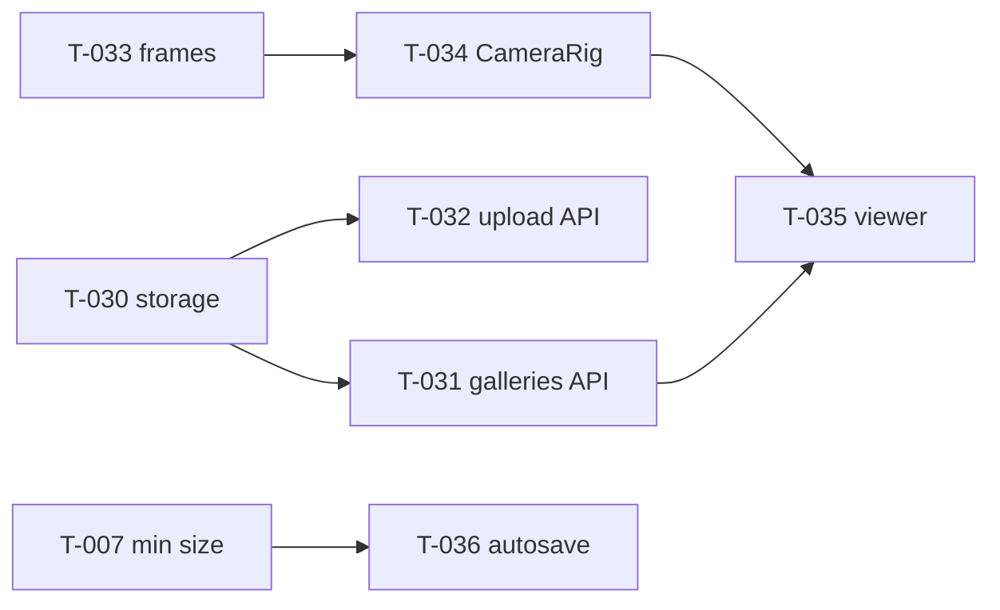

# Sprint 2: Content + publish

Status: **build** (Sprint 2 started 2026-10-10 after the Sprint 1 checkpoint passed). builder-1's cards (T-030 to T-036) are **approved and ready** (Quang, 2026-10-10), started early because builder-1 finished Sprint 1 ahead of builder-2. builder-2's cards (artwork upload UI, object panel, publish/edit-link UI, start screen) are drafted after T-025 merges, so they don't overlap the editor page. Hours 12–20 (plan.md §10); clock times TBD (freeze time unknown).

## Goal
Artwork objects (F3), 3D preview interactions (F6), save/publish (F7), viewer (F8).
**Checkpoint:** P0 complete on the deployed link (https://galliverse.vercel.app/), and a backup demo video recorded.
- A creator builds 3 rooms and hangs 2 artworks with stories.
- They publish and get view and edit links.
- A visitor opens the view link in another browser, tours with Previous/Next and click-to-travel, and opens plaques.
- Editing with the edit link works; editing without the key is refused.

## Lanes
| Lane A: builder-1 (server + 3D) | Lane B: builder-2 (editor UI), drafted 2026-10-10, new files only |
|---|---|
| T-030 storage adapter → T-031 galleries API, T-032 upload API | T-040 resize → T-041 upload button (needs T-032) → T-042 object panel |
| T-033 frames → T-034 CameraRig → T-035 viewer page | T-043 art markers (after T-023) |
| T-036 autosave (after T-007) | T-044 publish panel, T-045 start screen; **T-046 editor-page wiring** (autosave, publish, object panel, load by id+key) drafted after T-025 merges |

## Per agent
### builder-1 (Vic)
- **Owns (drafts):** T-030 to T-036.
- **Files:** `src/lib/storage/*`, `src/app/api/{files,galleries,upload}/**`, `src/lib/server/editKey.ts`, `src/viewer3d/{Frames,CameraRig,Plaque,roomOrder}*`, `src/viewer3d/Scene.tsx` (T-034 only), `src/app/g/[id]/page.tsx`, `src/store/autosave*`, `package.json` (T-030 only).
- **Read:** ADR-002, ADR-007, ADR-008, ADR-009; plan.md §3.5, §4 F3/F6/F7/F8, §7; AGENTS.md Gotchas (Next 16.4 route handlers/params).
- **Reference patterns:** R4, R5, R6 (CameraRig), R10 (clickable frames/floors), R11 (store flags), R2 (Suspense for textures).
### builder-2 (Parth)
- **Owns (drafts):** T-040 to T-045, plus T-046 later. Finish Sprint 1 (T-024, T-025) first. T-040, T-044 and T-045 have no dependencies; T-041 needs T-032; T-043 needs T-023.
- **Files:** `src/upload/*`, `src/panels/ObjectPanel*`, `src/editor2d/ArtMarkers*`, `src/components/{PublishPanel,publishClient}*`, `src/app/page.tsx`.
- **Reference patterns:** R11 (per-field subscriptions).
### reviewer (Vic): builder-2 PRs · reviewer-2 (Parth): builder-1 + devops PRs (ADR-011)
- **Security focus:** T-031 (edit-key hashing, constant-time compare, no hash leak, validation), T-032 (file type by magic bytes, size caps), T-030 (no path traversal in `/api/files`, no env values in logs).
### devops (Sergio)
- T-032's post-merge Vultr check on the Vercel deploy (deferred from T-006). Preview builds must be fixed for the Sprint 2 checkpoint (T-006).

## Retro
(written by the senior at sprint end)

## Early P0 check: visitor side (senior, 12:47Z, live https://galliverse.vercel.app/ at f966d21)
- **Publish via the live API:** `POST /api/galleries` returned 201 with id + edit key. Test gallery `OAuJN4Fr86aj6ozFRe051` (title "Senior P0 check (test, delete later)").
- **Viewer `/g/<id>`** in a fresh browser context: the title shows, the 3D view renders, it starts in the Entrance with the artwork frame on the north wall, Next goes to East Hall, Previous is present. No page errors.
- **Plaque:** clicking the artwork opens it (title shown, Close present); Esc closes it.
- **Missing gallery:** a friendly "This gallery doesn't exist" page.
- **Edit key:** PUT with a wrong key gives 403; with the right key gives 200 (title updated). GET never exposes the key hash.
- **Vultr:** artwork images are served from `atl2.vultrobjects.com/galliverse-bucket`.
- **Still to check for the full P0 checkpoint:** the creator side in the browser (hang art with the upload button + object panel, publish from the editor), which needs T-042 + T-046.

## Demo checklist (living; read before every demo run)
- [ ] Use https://galliverse.vercel.app/ (production) and confirm the latest `main` is deployed.
- [ ] Have a pre-published demo gallery link ready (T-052) as a fallback.

## P0 checkpoint: **PASS WITH A BLOCKING DEFECT** (corrected by the senior 13:55Z; originally reported as PASS) (senior, 13:13Z ≈ 09:15 EDT, live https://galliverse.vercel.app/ at d6fdb26)
Driven end to end in real browsers (Playwright), no page errors in any context:
1. **Creator:** start screen → "New blank gallery" → `/edit/local`. Added rooms with "Add room to the East" twice (**3 connected rooms**).
2. **Artwork:** "+ Add object" → uploaded an image through the Upload button (browser resize → `/api/upload` → Vultr) → title, artist, story → "Add artwork". Did this twice, in 2 rooms. The 3D editor preview shows 3 rooms, doorways, and both frames on the walls.
3. **Publish:** the panel shows the view link, the edit link and the "edit link is secret" warning. The editor URL switched to `/edit/<id>?key=…` (published gallery `PatVNiS6JWr0LBo48OAth`).
4. **Visitor**, in a fresh browser context: the view link opens the 3D tour in the Entrance with the uploaded artwork on the wall; Next/Previous move between rooms. Clicking the artwork opens the plaque with **title + artist + story**; Esc closes it.
5. **Edit-key rules** (checked via the API on the earlier test gallery): wrong key 403, right key 200, no hash leaked. The 404 page is friendly.
**Remaining for the Sprint 2 goal:** a backup demo video (humans), T-051 (demo-flow e2e) and T-052 (demo gallery).
- **Correction (senior, ~09:55 EDT):** uploaded artwork does **not render** in 3D. The frames show only the neutral placeholder. Cause: images load from `atl2.vultrobjects.com`, which sends no `Access-Control-Allow-Origin` header, so WebGL texture loads are blocked by CORS (browser: "blocked by CORS policy", `net::ERR_FAILED`). My earlier run missed it because the test image was the gray placeholder, the same color as an empty frame. **Lesson:** checkpoint images must be visually distinctive. Fix: T-072 (serve images same-origin via `/api/files`).
- **Defect fixed and P0 now a FULL PASS** (senior, 14:06Z, live b46990c, after T-072): uploaded a distinctive red/blue test image through the editor, published (`/g/erptmcXFS9E1fvufMbQLU`), and opened it in a fresh browser. The frame shows the red and blue halves. The image was served same-origin (`200 /api/files/images/<id>/medium.webp`), with **zero console/CORS errors**.
