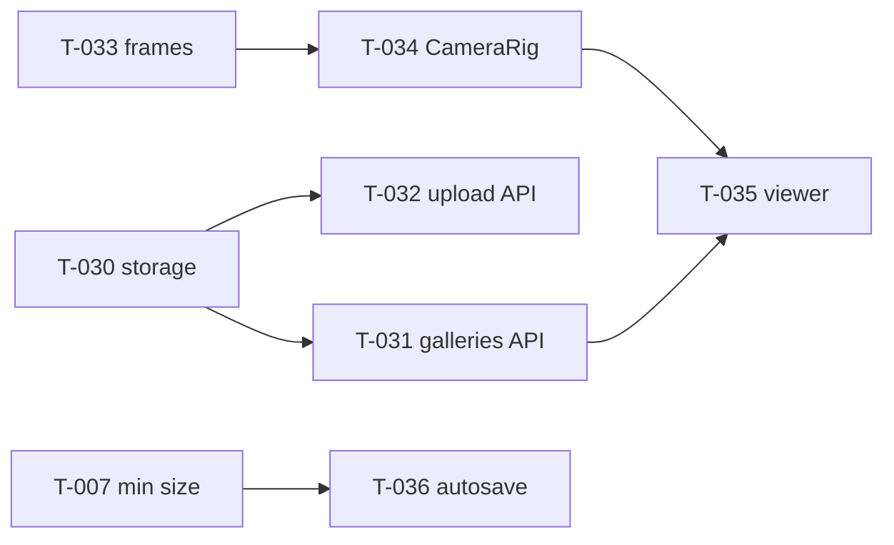

# Sprint 2: Content + publish

Status: **planning** (draft). builder-1's cards (T-030 to T-036) are drafted early because builder-1 finished Sprint 1 ahead of builder-2. builder-2's cards (artwork upload UI, object panel, publish/edit-link UI, start screen) are drafted after T-025 merges, so they don't overlap the editor page. Hours 12–20 (plan.md §10); clock times TBD (freeze time unknown).

## Goal
Artwork objects (F3), 3D preview interactions (F6), save/publish (F7), viewer (F8).
**Checkpoint:** P0 complete on the deployed link (https://galliverse.vercel.app/), and a backup demo video recorded.
- A creator builds 3 rooms and hangs 2 artworks with stories.
- They publish and get view and edit links.
- A visitor opens the view link in another browser, tours with Previous/Next and click-to-travel, and opens plaques.
- Editing with the edit link works; editing without the key is refused.

## Lanes
| Lane A: builder-1 (server + 3D) | Lane B: builder-2 (editor UI), drafted after T-025 |
|---|---|
| T-030 storage adapter → T-031 galleries API, T-032 upload API | upload button + browser resize (uses T-032) |
| T-033 frames → T-034 CameraRig → T-035 viewer page | object panel + art markers on walls |
| T-036 autosave (after T-007) | publish + edit-link UI, start screen, autosave wiring |

## Per agent
### builder-1 (Vic)
- **Owns (drafts):** T-030 to T-036.
- **Files:** `src/lib/storage/*`, `src/app/api/{files,galleries,upload}/**`, `src/lib/server/editKey.ts`, `src/viewer3d/{Frames,CameraRig,Plaque,roomOrder}*`, `src/viewer3d/Scene.tsx` (T-034 only), `src/app/g/[id]/page.tsx`, `src/store/autosave*`, `package.json` (T-030 only).
- **Read:** ADR-002, ADR-007, ADR-008, ADR-009; plan.md §3.5, §4 F3/F6/F7/F8, §7; AGENTS.md Gotchas (Next 16.4 route handlers/params).
- **Reference patterns:** R4, R5, R6 (CameraRig), R10 (clickable frames/floors), R11 (store flags), R2 (Suspense for textures).
### builder-2 (Parth)
- Finish Sprint 1 (T-021 to T-025) first. Sprint 2 cards will follow.
### reviewer (Vic)
- **Security focus:** T-031 (edit-key hashing, constant-time compare, no hash leak, validation), T-032 (file type by magic bytes, size caps), T-030 (no path traversal in `/api/files`, no env values in logs).
### devops (Sergio)
- T-032's post-merge Vultr check on the Vercel deploy (deferred from T-006). Preview builds must be fixed for the Sprint 2 checkpoint (T-006).

## Retro
(written by the senior at sprint end)
