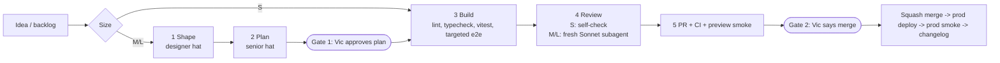

# Solo mode

After the hackathon, Vic builds Galleriverse alone. One agent session (the `/ship` skill in `pegasus-code`) does what five agents did, scaled to the size of the change. Decision record: `decisions/ADR-017-solo-mode.md`.

| Size | What | Feature file | Review |
|---|---|---|---|
| S | bugfix, copy, tweak; ≤3 files; no new deps | no (CHANGELOG line only) | self-check against a checklist |
| M | one feature on one surface | yes | one fresh Sonnet subagent |
| L | new deps, schema change, multiple surfaces, or >~400 lines | yes, plus an ADR | subagent, per M-sized PR |

## Files
- `BACKLOG.md`: ideas and carried-over work, one line each with a size guess. `/ship` proposes from the top.
- `_TEMPLATE.md`: the feature file. Copy it to `<YYYY-MM-DD>-<slug>.md` for each M/L change.
- `mockups/<slug>/`: screenshots for visual choices.
- `../releases/CHANGELOG.md`: one line per shipped PR (unchanged from team mode).

## Layout on Vic's laptop
- `pegasus-code/` is the only code checkout. It sits on a detached `origin/main` between changes, with one branch per change. Local, git-excluded: `.claude/skills/` (ship, pegasus-ui v3, design skills) and `PRODUCT.md`.
- `pegasus-docs/` is the `Docs` branch: this folder, ADRs, plans and the changelog.

## What solo mode suspends
Inbox messages, `send.sh`, `set-status.sh`, task cards, BOARD/SPRINT upkeep, reviewer routing and the devops merge gate. Everything else in AGENTS.md still applies: never push to `main` directly, never commit secrets, Docs never merges into `main`, and read the Next 16 docs before writing routes. When teammates are active, their work follows the team rules.
