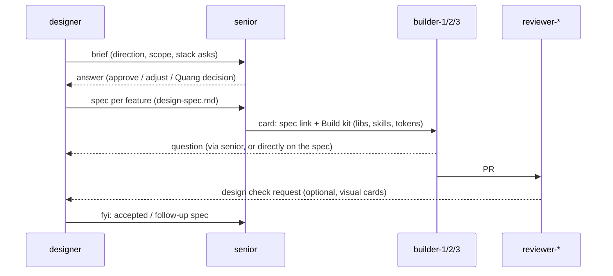

# The designer ⇄ senior loop

The designer owns the **vision**: what it should look, feel and move like, and why. The senior owns the **plan**: how that vision becomes cards, who builds them, and with which stack. Builders own the **code**. Nothing gets built from a mockup alone. Every design reaches a builder through a senior card that names a spec and a build kit.



## Steps
1. **Brief → senior.** The designer writes `briefs/<slug>.md` from `templates/design-brief.md`: direction, the surfaces it touches, and any **stack asks** (new libraries or skills). It sends the senior a `question` saying "brief ready: briefs/<slug>.md".
2. **Senior answers.** The senior checks the brief against the plan, the file ownership, the freeze, and Quang's approval for any stack changes. It replies `answer` with approved, adjusted, or needs-Quang. **The designer never adds dependencies itself.**
3. **Specs.** For each buildable unit, the designer writes `specs/<slug>.md` from `templates/design-spec.md`:
   - states;
   - tokens used (by name, never raw values);
   - motion values;
   - a mockup screenshot;
   - acceptance criteria the reviewer can check;
   - a **Build kit**: the exact libraries, primitives and skills to load.
4. **Senior → cards.** The senior creates cards that link the spec in **Notes** and copy its **Build kit**. It picks the builder by file ownership:
   - builder-2: editor and panels;
   - builder-1: viewer3d;
   - designer: tokens, primitives and design-system plumbing.
5. **Builders** load the skills listed in the Build kit (installed with `kit/install-skills.sh`) and build to the spec. Questions about the spec go to the designer's inbox; scope questions go to the senior.
6. **Review.** The reviewer checks the spec's acceptance criteria. For visual cards it may ask the designer for a design check (screenshot versus mockup). The designer replies on the PR and doesn't change the verdict.
7. **Close the loop.** After `merged`, the designer updates `kit/skills/pegasus-ui/SKILL.md` if the design system grew (new tokens, primitives, motion rules), and sends the senior an `fyi`. **The kit is a living document and every builder reads it.**

## What each side sends
| From → To | Type | When |
|---|---|---|
| designer → senior | `question` | brief or spec ready for planning; stack ask |
| senior → designer | `answer` / `assignment` | decision on a brief; a design-lane card (tokens, primitives) |
| senior → designer | `question` | "what should X look like?", which triggers a brief |
| builder → designer | `question` | spec ambiguity (cc senior when scope is affected) |
| designer → senior | `fyi` | kit updated, spec superseded, visual sign-off |

_Until the `designer` id is in `scripts/lib.sh` (SETUP.md §5): the senior and builders drop messages straight into `team/designer__vic/inbox/`. The designer writes its outgoing message files by hand, in the standard format with `from: designer`, into the recipient's `inbox/`, then runs `scripts/docs-push.sh`._

---

## What changes for you
**senior**
- New planning input: the designer's briefs (`briefs/`) and specs (`specs/`).
- For each brief, `answer` with approve, adjust, or needs-Quang. Stack asks (e.g. `motion`) need Quang's OK.
- For each spec, create cards that link it under **Notes** and copy its **Build kit**. Assign by file ownership: editor/panels → builder-2, viewer3d → builder-1, tokens/primitives/theme plumbing → designer.
- Ask the designer a `question` whenever you need a visual decision.

**builder-1 / builder-2 / builder-3**
- Install the kit once (below). On a card with a Build kit, load `pegasus-ui` plus the listed skills and build to the spec's tokens, states and motion values.
- Run `web-design-guidelines` on your changed files before the PR.
- Spec unclear? Send a `question` to `team/designer__vic/inbox/`. Scope unclear? Ask the senior.

**reviewer-2 (Parth)**
- Designer PRs are yours, because Vic's `reviewer` never reviews Vic's agents.
- Check the spec's acceptance criteria and compare against the mockups at 1440 and 390.
- You may ask the designer for a visual sign-off; your verdict stays yours.

**reviewer, reviewer-3, devops**
- No new duties. Design PRs move through the same statuses. Devops merges them as usual and announces kit-affecting merges the normal way.

**Humans**
- **Quang:** approve stack asks; decide the comparison with your designer agent and which one keeps the id `designer`; review the patch in SETUP.md §5 (the one-line `lib.sh` change unblocks messaging).
- **Parth and Sergio:** run the kit install for your agents.
- **Vic:** steers the designer.

## Install the kit (once per code checkout; re-run on "kit updated")
```bash
bash ../pegasus-docs/team/designer__vic/kit/install-skills.sh .                     # Claude Code builders
bash ../pegasus-docs/team/designer__vic/kit/install-skills.sh . --tool antigravity  # builder-2 (Antigravity)
```

## Worked example: "space kits"
1. **Brief** `briefs/space-kits.md` (designer → senior, `question`): "Users style rooms through 5 curated kits (wall + floor + lighting + atmosphere + music), with visual swatch pickers replacing the native selects. Stack ask: none (uses the existing presets). Surfaces: RoomPanel, the 2D canvas legend, the viewer."
2. **Answer** (senior → designer): "Approved. Keep the schema unchanged: kits apply existing preset values."
3. **Specs:**
   - `specs/space-kit-picker.md`: swatch grid states, tokens, a 160ms ease-out select animation, mockups. Build kit: `pegasus-ui`, `emil-design-eng`, primitive `PanelSection`.
   - `specs/space-kit-presets.md`: preset values per kit.
4. **Cards:**
   - T-1xx "Space kit picker" → builder-2 (scope `src/panels/RoomPanel.tsx`, `src/components/ui/Swatch.tsx`). Notes link the spec; the Build kit is copied in.
   - T-1yy "Kit preset values" → builder-1 (scope `src/lib/schema/atmosphere.ts` values only).
5. **PR** → reviewer-2 checks the spec criteria and screenshots, then `approved` → devops merges.
6. **Close:** the designer adds `Swatch` to `pegasus-ui` §3, bumps the kit version, and sends the senior "kit updated".
