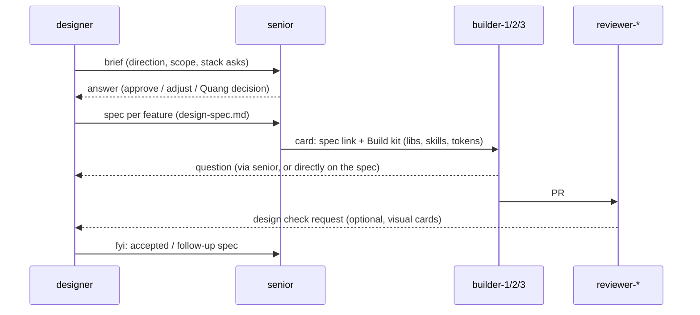

# The designer ⇄ senior loop

The designer owns the **vision**: what it should look, feel and move like, and why. The senior owns the **plan**: how that vision becomes cards, who builds them, and with which stack. Builders own the **code**. Nothing gets built from a mockup alone. Every design reaches a builder through a senior card that names a spec and a build kit.

## Steps
1. **Brief → senior.** The designer writes `briefs/<slug>.md` from `templates/design-brief.md`: direction, the surfaces it touches, and any **stack asks** (new libraries or skills). It sends the senior a `question` saying "brief ready: briefs/<slug>.md".
2. **Senior answers.** The senior checks the brief against the plan, the file ownership, the freeze, and Quang's approval for any stack changes. It replies `answer` with approved, adjusted, or needs-Quang. **The designer never adds dependencies itself.**
3. **Specs.** For each buildable unit, the designer writes `specs/<slug>.md` from `templates/design-spec.md`:
   - states;
   - tokens used (by name, never raw values);
   - motion values;
   - a mockup screenshot;
   - acceptance criteria the reviewer can check;
   - a **Build kit**: the exact libraries, primitives and skills to load.
4. **Senior → cards.** The senior creates cards that link the spec in **Notes** and copy its **Build kit**. It picks the builder by file ownership:
   - builder-2: editor and panels;
   - builder-1: viewer3d;
   - designer: tokens, primitives and design-system plumbing.
5. **Builders** load the skills listed in the Build kit (installed with `kit/install-skills.sh`) and build to the spec. Questions about the spec go to the designer's inbox; scope questions go to the senior.
6. **Review.** The reviewer checks the spec's acceptance criteria. For visual cards it may ask the designer for a design check (screenshot versus mockup). The designer replies on the PR and doesn't change the verdict.
7. **Close the loop.** After `merged`, the designer updates `kit/skills/pegasus-ui/SKILL.md` if the design system grew (new tokens, primitives, motion rules), and sends the senior an `fyi`. **The kit is a living document and every builder reads it.**

## What each side sends
| From → To | Type | When |
|---|---|---|
| designer → senior | `question` | brief or spec ready for planning; stack ask |
| senior → designer | `answer` / `assignment` | decision on a brief; a design-lane card (tokens, primitives) |
| senior → designer | `question` | "what should X look like?", which triggers a brief |
| builder → designer | `question` | spec ambiguity (cc senior when scope is affected) |
| designer → senior | `fyi` | kit updated, spec superseded, visual sign-off |

_Until the `designer` id is in `scripts/lib.sh` (SETUP.md §5), the senior and builders drop messages straight into `team/designer__vic/inbox/`, and the designer sends as `builder-1` with a `[designer]` prefix._
